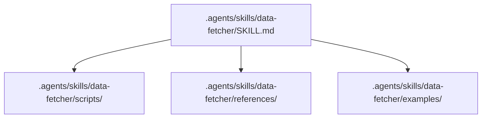

# data-fetcher Skill Package (`data-fetcher`)

Skill for retrieving external market, macro, or telemetry data.

## Architecture

## Description
Provides instructions for fetching and caching macro, market, and telemetry data.
