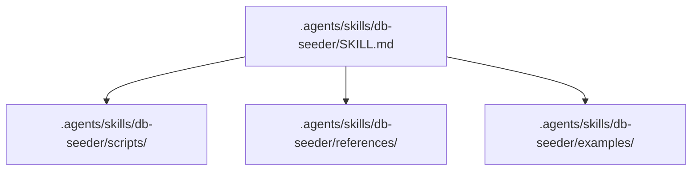

# db-seeder Skill Package (`db-seeder`)

Skill for populating local test SQLite databases and trade journal data.

## Architecture

## Description
Seeds local database tables and trade journal fixtures for offline backtesting and integration testing.
