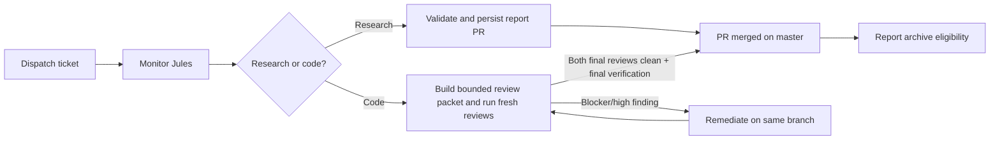

# Jules Orchestration Skill Package (`jules-orchestration`)

Coordinates the Gelt parent-agent workflow around Jules sessions and makes human handoffs explicit.

## Lifecycle

All user-facing updates include separate **Your actions** and **Status updates** tables.

Ticket acceptance is identical for local and Jules implementation: implement, verify, build an actual-diff review packet, fresh independent and adversarial review, remediate, repeat review after every change, then final verification. The packet constrains repository discovery to changed files and named seams without weakening review criteria. Jules only supplies an external implementer/remediator and requires parent monitoring while that work runs.
