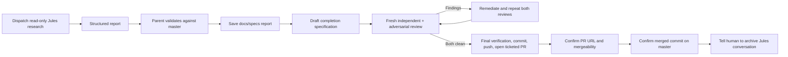

# Jules Research Handoff Skill Package (`jules-research-handoff`)

Standardizes read-only Jules research sessions and ensures their validated findings are persisted through a ticketed documentation PR before the human archives the session.

## Lifecycle

The parent agent owns persistence, the complete `ticket-delivery` review loop, and reporting. Jules owns research only. Any report, specification, or other ticket artifact change restarts fresh final reviews and final verification. The human retains the conversation until the associated PR is merged.
