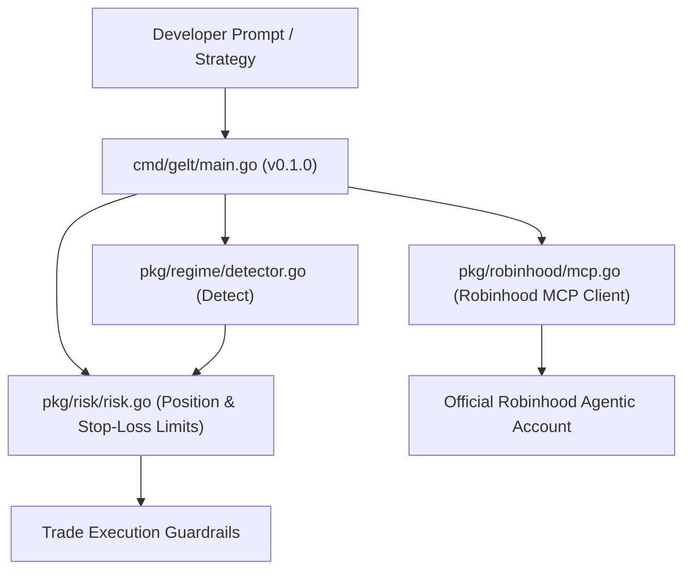

# Gelt 🪙

## Current V2 status (2026-10-06; partial, execution disabled)

Source was checked at [master `d78c39f`](https://github.com/Zkrausman/Gelt/tree/d78c39f146a18a567b3cf6a836eb51bd5ab27ae9).
V1 Go code, history and guardrails remain preserved. V2 includes the offline
foundation, protected M3 account-connection boundary, worker-owned M4 SQLite
ledger, internal M5 order lifecycle, M6 connection/simulation UI, M7 read-only
ledger history and a partial M8 home workspace. The M5 lifecycle and synthetic
companion components are not wired into a production order path. Production
execution, preview, confirmation, dispatch, cancellation and reconciliation
capabilities remain false.

Hosted Go, Ubuntu Node 22 and native Windows Node 22 checks passed for that
source head; [exact jobs and retained failures](v2/README.md#current-source-and-hosted-disposition-2026-10-06)
are recorded in the V2 README. These automated offline checks do not establish
live OAuth/browser/provider compatibility, owner-machine portability or release
acceptance. **M8 remains open.** Exact-order authorization, supervised
reconciliation and explicit owner acceptance remain separate gates; see
[ZAR-219](docs/specs/ZAR-219-Integrated-Offline-Trading-Screen.md).

## Historical M2 foundation snapshot — ZAR-213 (2026-09-18)

The following snapshot describes the M2 checkpoint only; the dated current status
above supersedes its module-absence and pending-gate statements.

Owner capability GO authorizes the non-executing OpenTerminal-derived foundation
under `v2/`; V1 Go code/history/guardrails remain intact. The web landing page,
market backend and disabled worker run offline on loopback, without brokers or
the legacy daemon. See the [M2 specification](docs/specs/ZAR-213-V2-Baseline.md) for startup commands,
exact upstream pin/license/import accounting, security boundaries and actual
local checks. M3 account protection, M4 ledger and M5+ orders are **not** present.
Parent-owned archival publication, PR/CI and review gates are not claimed here;
stop before merge. Earlier V1/cloud roadmap material below is historical context,
not authority to deploy or trade.

**Gelt** is a local agentic trading engine and financial governance suite designed for Robinhood Agentic Trading via the Model Context Protocol (MCP).

## Core Architecture

Gelt is built to provide robust, localized, and cost-effective trading capabilities, connecting directly to Robinhood through the Model Context Protocol. The architecture consists of several key components:

- **Go Backend**: The core trading engine and CLI tool built in Go for performance, concurrency, and reliability.
- **Robinhood MCP Integration**: Facilitates the direct connection to your Robinhood agentic account to safely and securely submit trades.
- **Macro Matrix**: Constantly polls macroeconomic indicators (EFFR, CPI, 10-Year Treasury Yields, NFP via the FRED API) to fuel passive market regime detection and adapt strategies accordingly.
- **SQLite Trade Journal**: A fully local embedded database for persisting trade records, metrics, and application state without heavy infrastructure requirements.
- **Options Engine**: A dedicated engine within the ecosystem for analyzing, strategizing, and executing option trades.



## Features

- **Robinhood Agentic Trading MCP Connector**: Configures and interacts with Robinhood's official MCP server URL.
- **Risk Governance Engine**: Enforces position sizing caps, trade limits, and stop-loss rules locally before orders reach the market.
- **Single-Subscription Local Execution**: Optimized for local operation with zero cloud API costs.
- **Squire & Thneed Compliant**: Implements `version` command and structured Mermaid architecture indexing.

## Developer Workflows

Standard commands for developing and testing the Gelt application:

```bash
# Build the CLI binary
go build -o gelt.exe ./cmd/gelt

# Run the entire test suite
go test ./...

# Run the comprehensive test-suite via CLI
./gelt.exe test-suite
```

## Usage

### Supplied-CSV offline analysis

Start with `gelt help offline` to choose an existing diagnostic or strategy
comparison, then `gelt help NAME` for exact syntax. Global `gelt help`, `--help`
and `-h` list the supplied-CSV commands. Each also accepts a sole `--help`
or `-h` operand without opening an input file or loading configuration.

`gelt backtest-causal-aligned-window-compare SYMBOL CSV START END CASH FIXED_FEE FEE_BPS BUY_BPS SELL_BPS`
uses one admitted input for the fixed BreakoutVol, TrendConfluence and
MeanReversion families over one exact scoring interval. It preserves native
20/50/20 prior histories, validates each result and checks complete shared
cash/passive paths before writing the three summaries. START needs at least
50 prior rows. It adds no ranking or operating qualification; use its exact help
for argument order and the retained native limits.

Use `gelt diagnose-causal-csv ./supplied-bars.csv` to locate a syntax or common
bar-domain issue before choosing a replay. It reports a fixed reason and, when
known, a one-based physical line and field, without changing the input or
echoing its values. A valid one-row file may pass; symbol, costs, warmup,
strategy and operating admission are not checked. For filenames literally
`--help` or `-h`, supply `./--help` or `./-h`.

| Strategy | Whole input | Selected period |
| --- | --- | --- |
| BreakoutVol | `backtest-causal-compare` | `backtest-causal-window-compare` |
| TrendConfluence | `backtest-causal-trend50-compare` | `backtest-causal-trend50-window-compare` |
| MeanReversion | `backtest-causal-meanrev-compare` | Same command with trailing `--window START END` |

These compare the strategy with flat cash and one passive lot. Separate
BreakoutVol diagnostics are `backtest-causal` (reference replay),
`backtest-causal-funded` (declared cash), `backtest-causal-fees` (filled-side
fees), and `backtest-causal-execution` (adverse execution prices).

BreakoutVol and MeanReversion use a fixed 20-close warmup, first evaluation at
index 19 and first eligible next-open fill at index 20. TrendConfluence uses a
fixed 50-close profile, evaluation at 49 and fill at 50. Indices are zero-based;
these are existing profiles, with no strategy ranking or parameter tuning.

Input is strict, supplied CSV with the exact header
`Timestamp,Open,High,Low,Close,Volume`. Selected periods require exact supplied
timestamps, a nonempty score interval and exactly 20/50 prior warmup rows; END
may also be the complete source's last timestamp plus one second. All original
rows are validated. Finite-prefix reseeding can differ from filtering a
whole-history run, including RSI/EMA memory.

See the [CLI input, cost and window guide](cmd/gelt/README.md#supplied-csv-offline-analysis)
for bounds and argument order. Costs/defaults are uncalibrated; supplied-data
authenticity, adequate/converged history, cadence/session eligibility, edge,
profitability and operating admission remain unestablished. The legacy
`backtest <Plan|Strategy> <Symbol> [DataFile.csv | Days]` is a separate CSV or
generated-synthetic diagnostic.

```bash
./gelt.exe help offline
./gelt.exe help backtest-causal-window-compare
./gelt.exe backtest-causal-meanrev-compare --help
```

### Other CLI examples

```bash
# Check version
./gelt.exe version

# Inspect risk governance limits
./gelt.exe risk

# Configure Robinhood Agentic Trading MCP Server URL
./gelt.exe config set-url "https://mcp.robinhood.com/v1/agentic/YOUR_ID"

# Launch the dashboard / telemetry server
./gelt.exe dashboard
```
