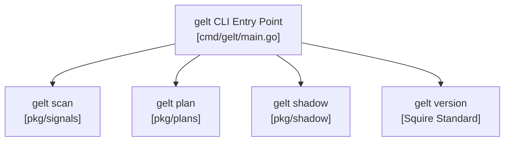

# Gelt CLI Engine (`cmd/gelt`)

The `cmd/gelt` package provides the command-line interface entry point for Gelt, handling subcommands for universe scanning, active trading plan management, shadow leaderboard inspection, and live engine execution.

## Architecture & Component Topology

## Supported Commands

- `gelt scan`: Runs Universe Screener and prints Confluence scores.
- `gelt plan`: Inspects or switches active trading plans (`gelt plan set <name>`).
- `gelt shadow`: Manages shadow strategy forward-testing and cycle snapshots (`gelt shadow cycles`).
- `gelt version`: Emits Squire-compliant semantic version metadata.
