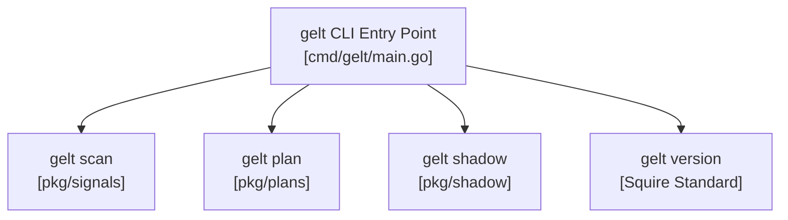

# Gelt CLI Engine (`cmd/gelt`)

The `cmd/gelt` package provides the command-line interface entry point for Gelt, handling subcommands for universe scanning, active trading plan management, shadow leaderboard inspection, and live engine execution.

## Supplied-CSV offline analysis

`gelt help` (also `gelt --help` or `gelt -h`) lists the supplied-CSV commands
separately from the other CLI interfaces. `gelt help offline` shows a chooser and
common input guidance. `gelt help NAME`, `NAME --help` and `NAME -h` produce the
same exact syntax and notes for the commands below. Help uses static text
and the build version; it does not read data/configuration or run a command.

`gelt backtest-causal-aligned-window-compare <Symbol> <CSV> <StartInclusiveUnix> <EndExclusiveUnix> <InitialCash> <FixedFee> <FeeBps> <BuyBps> <SellBps>`
takes exactly nine operands, with no target argument. It admits and parses one
supplied CSV, closes it once and retains an unchanged original for validation.
It invokes native TrendConfluence50, fresh default BreakoutVol20 and
MeanReversion20 selected-period APIs once each, sequentially, stopping on any
failure. Every family keeps its existing finite-prefix history and defaults;
START therefore needs at least 50 preceding rows and a nonempty exact interval.

The command validates each unchanged native summary against the original input
and declarations, then compares the complete scored cash/passive economic paths,
entries, basis, fees, peaks and drawdowns. Only the distinct native model/policy
identities, passive reason, flat warmup marks and local indices are normalized
after validation. Strategy results are not required to agree. The final report
has common source/window metadata followed by full native summaries in fixed
BreakoutVol, TrendConfluence, MeanReversion order, with no ranking or tuning.

Failures exit 1 with one fixed stderr diagnostic of the form
`backtest-causal-aligned-window-compare: FAMILY: CODE`, at most 512 UTF-8 bytes
including usage for wrong arity. Unknown/inconsistent errors become
`input: replay_failed`. Cancellation is attributed to input before native work,
the active native family after its call/summary, alignment during projection or
comparison, and output at the final pre-write check. Parse/close errors precede
post-read cancellation. No I/O preemption or snapshot of concurrent file writes
is promised. Success writes once only after all work passes: header at most
2048 bytes, each native body at most 8192, complete UTF-8 report at most 32768.
Nil/short/error stdout returns `output: output_error` without retry; a prefix may
remain and nonzero output is incomplete. Detailed help retains its separate
16384-byte cap. Literal CSV filenames `--help`/`-h` among nine operands are data.

`gelt diagnose-causal-csv <DataFile.csv>` checks the complete supplied input for
CSV syntax and common numeric/bar-domain admission without creating an engine,
selecting a strategy, parsing symbol/cost declarations or replaying. A valid
one-row file may pass. It does not check source authenticity, warmup, history,
symbol, costs, strategy or operating admission, and it does not change input.

On failure it emits one fixed diagnostic on stderr and exits 1:

```text
diagnose-causal-csv: invalid_csv line=23 field=High reason=noncanonical_number
```

Physical lines are one-based, including header line 1; the first data row is
line 2. `line=none field=none` means no particular cell is identified. Complete
bounded read, UTF-8 and row count checks precede header/row syntax; all syntax
checks precede domain checks. Thus a later malformed token can precede an
earlier domain-invalid price. A combined geometry fault identifies `OHLC`,
without guessing a particular price. Values, rows, paths and OS/parser error
text are not echoed. Success exits 0 with only:

```text
Causal CSV syntax/domain check: passed
Data rows: N
Scope: unqualified input only; symbol, costs, warmup, strategy and operating admission not checked.
```

Each report, including usage/error, is valid UTF-8 and at most 512 bytes before
one write attempt. A failed success write exits 1 and attempts only fixed
`diagnose-causal-csv: output_error` on stderr; a prefix can already exist.
Cancellation is checked before opening and after successful parsing/closing,
then again before success. Read/parse/close failures take precedence over
post-read cancellation. No I/O deadline or concurrent-file snapshot is promised.

| Command | Literal target | Purpose and period |
| --- | --- | --- |
| `backtest-causal-aligned-window-compare` | none | Fixed three-family comparison over one exact interval |
| `diagnose-causal-csv` | none | Locate a syntax/domain issue in complete supplied input |
| `backtest-causal` | `BreakoutVol` | Reference signal/next-open replay |
| `backtest-causal-funded` | `BreakoutVol` | Declared-cash affordability diagnostic, zero modeled costs |
| `backtest-causal-fees` | `BreakoutVol` | Fixed and bps fees on filled sides |
| `backtest-causal-execution` | `BreakoutVol` | Declared fees plus adverse buy/sell prices |
| `backtest-causal-compare` | `BreakoutVol` | Whole-input strategy/cash/passive comparison |
| `backtest-causal-window-compare` | `BreakoutVol` | Selected-period comparison |
| `backtest-causal-trend50-compare` | `TrendConfluence` | Whole-input comparison, fixed 50-close profile |
| `backtest-causal-trend50-window-compare` | `TrendConfluence` | Selected-period comparison, fixed 50-close profile |
| `backtest-causal-meanrev-compare` | `MeanReversion` | Whole-input comparison or trailing `--window START END` |

BreakoutVol and MeanReversion have a fixed 20-close warmup, first evaluation at
zero-based index 19 and first eligible next-open fill at index 20.
TrendConfluence has a fixed 50-close warmup, evaluation at 49 and fill at 50.
MeanReversion retains its owned Bollinger 20 x2, RSI14 35/65, and ATR proxy14
stop/target 0.5/1.5 defaults. Defaults and declared costs are uncalibrated; the
chooser does not rank strategies or tune parameters.

The dedicated window commands place START/END **before** cash and cost
arguments. MeanReversion places `--window START END` **after** them. For example,
using an inert placeholder path to an already supplied file:

```bash
gelt help backtest-causal-trend50-window-compare
gelt backtest-causal-compare BreakoutVol SYMBOL ./supplied-bars.csv 100 0 0 0 0
gelt backtest-causal-meanrev-compare MeanReversion SYMBOL ./supplied-bars.csv 100 0 0 0 0
```

On Linux, supplied CSV inputs must open as regular files; symlinks to regular
files remain supported. FIFOs, directories and devices return `input_file`,
including streams that previously happened to parse. This admission rule avoids
FIFO peer/EOF waits; it does not promise a deadline for all filesystem I/O or
freeze concurrent writes to an admitted file.

The CSV header must be exactly `Timestamp,Open,High,Low,Close,Volume`. Supply
strictly increasing Unix-second timestamps in 1..253402300799. Numeric tokens
use canonical unsigned ASCII integer/decimal syntax, with no leading-zero
integer part, quoting, BOM, whitespace, sign or exponent. LF/CRLF are accepted.
Limits are 1 MiB (1048576 bytes), 10000 rows and 32 bytes per numeric token.
Finite OHLC values must be 0.01..1000000 with
`Low <= Open/Close <= High`; volume is 0..1e12. OHLC parsing uses float64, not
exact-decimal arithmetic.

Where present, cash is fixed8 (up to eight fractional digits) in 0..1000000,
fixed filled-side fee is fixed8 in 0..<10, fee bps is an unsigned integer in
0..10000, and buy/sell adverse bps are unsigned integers in 0..9999. The simulated
entry cap is 10 including entry fee. There is no cash resizing, loan, forced
terminal sale or SELL cost without a SELL. Comparisons include flat cash and
one passive lot held to the final supplied close for whole-input comparisons,
or the final scored close for selected periods; equal cost declarations do not
imply equal exposure or risk.

Window START is inclusive and END exclusive. Both must be exact supplied
timestamps, except END may equal the **complete source's last timestamp plus
one second**, not the next cadence interval. A nonempty score interval and
exactly 20/50 preceding warmup rows are required; excluded original rows are
also validated. The finite consumed prefix is reseeded, which can differ from
filtering full history, including RSI/EMA memory.

Supplied-data authenticity, adequate/converged history, cadence/session
eligibility, statistical edge, profitability and operating admission remain
unestablished. These commands do not acquire live data. The legacy
`backtest <Plan|Strategy> <Symbol> [DataFile.csv | Days]` remains a separate
CSV/generated-synthetic diagnostic.

Help topics are closed: unsupported topics (including `help buy` and
`help dashboard`) return `gelt help: unsupported_topic`; multiple topic tokens
return `gelt help: invalid_arguments`. Only a sole `--help`/`-h` operand for one
of the listed commands is intercepted. For `diagnose-causal-csv`, filenames
literally `--help` or `-h` must be supplied as `./--help` or `./-h`. A full
existing replay/comparison invocation containing a data
filename literally `--help`, mixed operands and all other command grammar keep
their existing parsing and admission. No general operational-command help alias
is added. No arguments still print global usage and exit 1; unknown top-level
commands retain their existing raw prefix and usage behavior.

New help bodies are nonempty UTF-8, at most 16384 bytes, with one stdout write
attempt. Invalid rendered output returns `gelt help: invalid_output` before
stdout; nil/short/error stdout returns `gelt help: output_error`. There is at
most one stderr attempt and no retry; a failed stdout attempt can be partial.

## Architecture & Component Topology



## Supported Commands

- `gelt scan`: Runs Universe Screener and prints Confluence scores.
- `gelt plan`: Inspects or switches active trading plans (`gelt plan set <name>`).
- `gelt shadow`: Manages shadow strategy forward-testing and cycle snapshots (`gelt shadow cycles`).
- `gelt version`: Emits Squire-compliant semantic version metadata.
