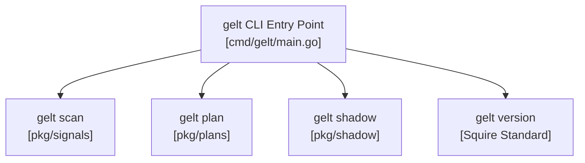

# Gelt CLI Engine (`cmd/gelt`)

The `cmd/gelt` package provides the command-line interface entry point for Gelt, handling subcommands for universe scanning, active trading plan management, shadow leaderboard inspection, and live engine execution.

## Supplied-CSV offline analysis

`gelt help` (also `gelt --help` or `gelt -h`) lists the supplied-CSV commands
separately from the other CLI interfaces. `gelt help offline` shows a chooser and
common input guidance. `gelt help NAME`, `NAME --help` and `NAME -h` produce the
same exact syntax and notes for the nine commands below. Help uses static text
and the build version; it does not read data/configuration or run a command.

| Command | Literal target | Purpose and period |
| --- | --- | --- |
| `backtest-causal` | `BreakoutVol` | Reference signal/next-open replay |
| `backtest-causal-funded` | `BreakoutVol` | Declared-cash affordability diagnostic, zero modeled costs |
| `backtest-causal-fees` | `BreakoutVol` | Fixed and bps fees on filled sides |
| `backtest-causal-execution` | `BreakoutVol` | Declared fees plus adverse buy/sell prices |
| `backtest-causal-compare` | `BreakoutVol` | Whole-input strategy/cash/passive comparison |
| `backtest-causal-window-compare` | `BreakoutVol` | Selected-period comparison |
| `backtest-causal-trend50-compare` | `TrendConfluence` | Whole-input comparison, fixed 50-close profile |
| `backtest-causal-trend50-window-compare` | `TrendConfluence` | Selected-period comparison, fixed 50-close profile |
| `backtest-causal-meanrev-compare` | `MeanReversion` | Whole-input comparison or trailing `--window START END` |

BreakoutVol and MeanReversion have a fixed 20-close warmup, first evaluation at
zero-based index 19 and first eligible next-open fill at index 20.
TrendConfluence has a fixed 50-close warmup, evaluation at 49 and fill at 50.
MeanReversion retains its owned Bollinger 20 x2, RSI14 35/65, and ATR proxy14
stop/target 0.5/1.5 defaults. Defaults and declared costs are uncalibrated; the
chooser does not rank strategies or tune parameters.

The dedicated window commands place START/END **before** cash and cost
arguments. MeanReversion places `--window START END` **after** them. For example,
using an inert placeholder path to an already supplied file:

```bash
gelt help backtest-causal-trend50-window-compare
gelt backtest-causal-compare BreakoutVol SYMBOL ./supplied-bars.csv 100 0 0 0 0
gelt backtest-causal-meanrev-compare MeanReversion SYMBOL ./supplied-bars.csv 100 0 0 0 0
```

On Linux, supplied CSV inputs must open as regular files; symlinks to regular
files remain supported. FIFOs, directories and devices return `input_file`,
including streams that previously happened to parse. This admission rule avoids
FIFO peer/EOF waits; it does not promise a deadline for all filesystem I/O or
freeze concurrent writes to an admitted file.

The CSV header must be exactly `Timestamp,Open,High,Low,Close,Volume`. Supply
strictly increasing Unix-second timestamps in 1..253402300799. Numeric tokens
use canonical unsigned ASCII integer/decimal syntax, with no leading-zero
integer part, quoting, BOM, whitespace, sign or exponent. LF/CRLF are accepted.
Limits are 1 MiB (1048576 bytes), 10000 rows and 32 bytes per numeric token.
Finite OHLC values must be 0.01..1000000 with
`Low <= Open/Close <= High`; volume is 0..1e12. OHLC parsing uses float64, not
exact-decimal arithmetic.

Where present, cash is fixed8 (up to eight fractional digits) in 0..1000000,
fixed filled-side fee is fixed8 in 0..<10, fee bps is an unsigned integer in
0..10000, and buy/sell adverse bps are unsigned integers in 0..9999. The simulated
entry cap is 10 including entry fee. There is no cash resizing, loan, forced
terminal sale or SELL cost without a SELL. Comparisons include flat cash and
one passive lot held to the final supplied close for whole-input comparisons,
or the final scored close for selected periods; equal cost declarations do not
imply equal exposure or risk.

Window START is inclusive and END exclusive. Both must be exact supplied
timestamps, except END may equal the **complete source's last timestamp plus
one second**, not the next cadence interval. A nonempty score interval and
exactly 20/50 preceding warmup rows are required; excluded original rows are
also validated. The finite consumed prefix is reseeded, which can differ from
filtering full history, including RSI/EMA memory.

Supplied-data authenticity, adequate/converged history, cadence/session
eligibility, statistical edge, profitability and operating admission remain
unestablished. These commands do not acquire live data. The legacy
`backtest <Plan|Strategy> <Symbol> [DataFile.csv | Days]` remains a separate
CSV/generated-synthetic diagnostic.

Help topics are closed: unsupported topics (including `help buy` and
`help dashboard`) return `gelt help: unsupported_topic`; multiple topic tokens
return `gelt help: invalid_arguments`. Only a sole `--help`/`-h` operand for one
of the nine commands is intercepted. A full invocation containing a data
filename literally `--help`, mixed operands and all other command grammar keep
their existing parsing and admission. No general operational-command help alias
is added. No arguments still print global usage and exit 1; unknown top-level
commands retain their existing raw prefix and usage behavior.

New help bodies are nonempty UTF-8, at most 16384 bytes, with one stdout write
attempt. Invalid rendered output returns `gelt help: invalid_output` before
stdout; nil/short/error stdout returns `gelt help: output_error`. There is at
most one stderr attempt and no retry; a failed stdout attempt can be partial.

## Architecture & Component Topology



## Supported Commands

- `gelt scan`: Runs Universe Screener and prints Confluence scores.
- `gelt plan`: Inspects or switches active trading plans (`gelt plan set <name>`).
- `gelt shadow`: Manages shadow strategy forward-testing and cycle snapshots (`gelt shadow cycles`).
- `gelt version`: Emits Squire-compliant semantic version metadata.
