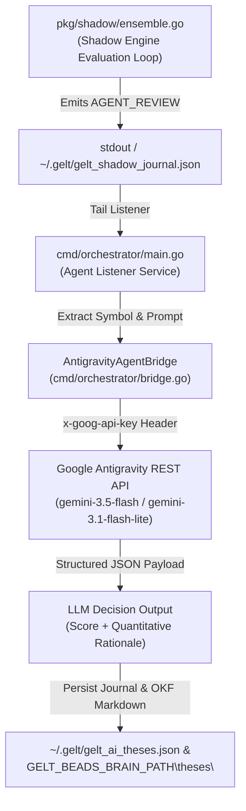

# cmd/orchestrator: LLM Agent Listener Service

## 1. Overview & Architecture

The `cmd/orchestrator` package provides a lightweight event-listener service for Gelt's non-deterministic AI strategies. It continuously monitors standard input log streams and shadow journal stores for `AGENT_REVIEW` signals emitted by [`pkg/strategies/ai_choice_crypto.go`](../../pkg/strategies/ai_choice_crypto.go).

Upon intercepting an `AGENT_REVIEW` signal payload, the orchestrator invokes the `AntigravityAgentBridge.EvaluateThesis(ctx, symbol, prompt)` interface to make live REST calls to Google Antigravity / Gemini API endpoints via `x-goog-api-key`.



## 2. Environment Variables (`.env`)

The Orchestrator relies on key environment variables configured in `.env` or process environment:

| Variable | Description | Example / Default | Required |
| :--- | :--- | :--- | :--- |
| `GEMINI_API_KEY` | Google Antigravity / Gemini REST API key. Passed via `x-goog-api-key` HTTP header. | `set only in the local environment` | **Yes** |
| `GEMINI_MODELS` | Comma-separated list of authorized Gemini model names sampled randomly per request. | `gemini-3.5-flash,gemini-2.5-flash,gemini-3.6-flash,gemini-3.5-flash-lite,gemini-2.5-flash-lite,gemini-3-flash,gemini-3.1-flash-lite` | Optional (Defaults to 7-model pool) |
| `GELT_BEADS_BRAIN_PATH` | Optional local directory for thesis reports. | `GELT_BEADS_BRAIN_PATH` | Optional |

## 3. Usage

### Running Orchestrator Standalone
```powershell
go run ./cmd/orchestrator
```

### Piping Logs from Gelt CLI
```powershell
.\gelt.exe shadow --plan config/plans/shadow_crypto_ab_test.yaml | .\orchestrator.exe
```
