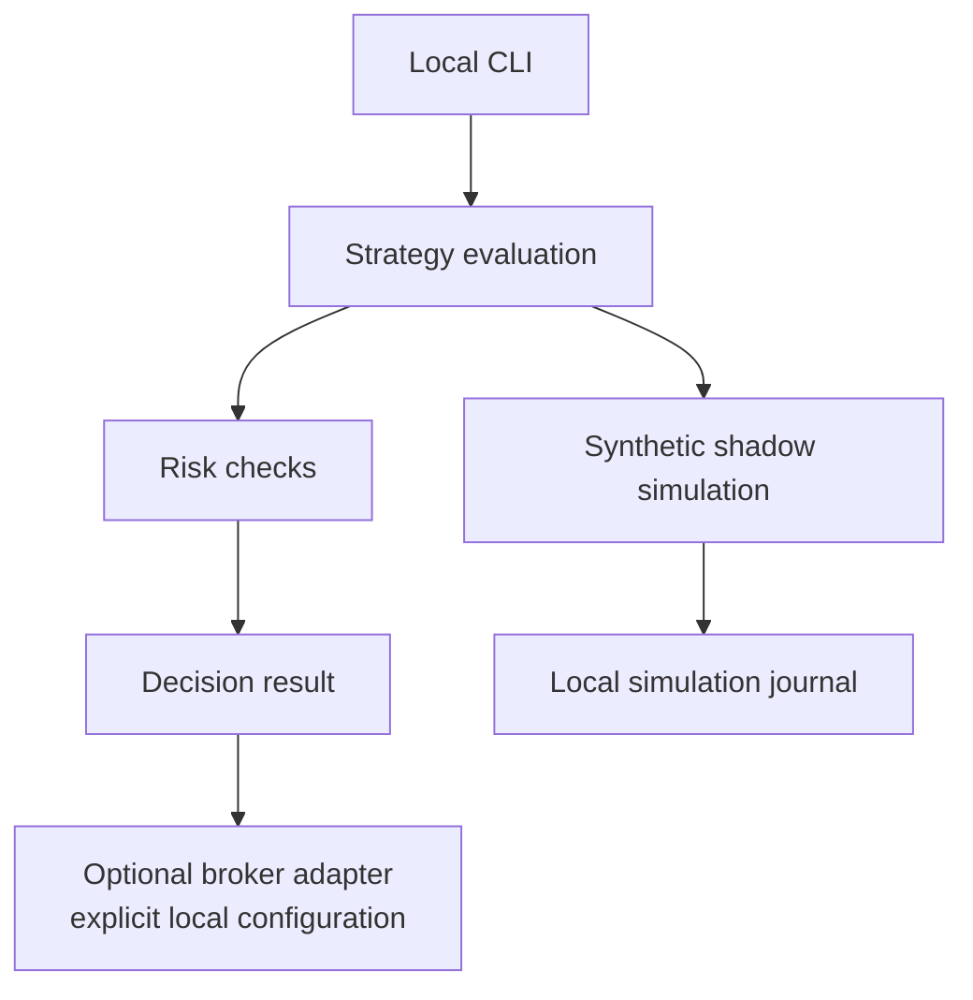

# Gelt: Strategy Engine and Synthetic Examples

> **Synthetic examples only:** Every account alias, symbol, order, price, quantity, and result in this document is invented for illustration. Nothing here describes a real account, order, position, broker session, test run, or strategy performance.

## Overview

Gelt is a Go codebase for strategy evaluation, risk checks, and optional broker connectivity. Broker settings are supplied through the existing local configuration. The health diagnostic requires an explicitly configured account identifier and reports an unconfigured state when it is absent; it does not substitute a built-in identifier.

The repository includes a shadow-trading path for simulated strategy comparisons. The example below is a hand-written fixture, not recorded trading activity.

## Architecture



Broker connectivity is optional. Unit tests use local fixtures such as `httptest`; examples in this document do not call a broker.

## Components

| Area | Role |
| :--- | :--- |
| Strategy catalog | Evaluates strategy inputs and emits decisions. |
| Risk checks | Applies configured limits and circuit-breaker behavior. |
| Broker adapter | Uses explicit local configuration when a user chooses to connect it. |
| Shadow simulation | Compares plans using simulated records without representing account activity. |

## Synthetic trade fixture

This sample is fabricated test data. `DEMO` and `acct-demo-001` are fictional labels; the sample is not a submitted order or a performance claim.

```json
{
  "account_alias": "acct-demo-001",
  "symbol": "DEMO",
  "side": "buy",
  "quantity": 2,
  "entry_price": 10.00,
  "exit_price": 11.00,
  "synthetic_pnl": 2.00,
  "source": "illustrative_fixture_only"
}
```

## Local verification

Run focused offline package tests when changing these components, for example `go test ./pkg/health`. Review the selected package tests before running them to confirm they use local fixtures and do not invoke live trading.
