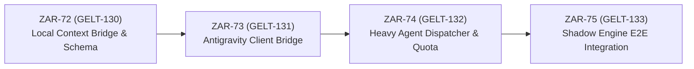

# 📜 EPIC SPECIFICATION: Tiered Antigravity Agent API Integration & Shared Context Bridge

**Epic Identifier:** `EPIC-GELT-09`  
**Linear Project:** [`[EPIC] Tiered Antigravity Agent API Integration & Shared Context Bridge`](https://linear.app/geltagentictrading/project/epic-tiered-antigravity-agent-api-integration-and-shared-context-e32cd3fe2d2d)  
**Target Artifact:** `docs/specs/EPIC_Antigravity_Agent_API.md`  
**Author:** Lead Technical Product Manager & Principal Quantitative Engineer  
**Date:** August 2, 2026  
**Status:** APPROVED FOR EXECUTION  

---

## 1. Executive Summary & Architectural Vision

This epic implements a **two-tiered AI execution architecture** for Gelt. It decouples high-frequency, low-latency market tick evaluations (Fast REST calls or local technical signals) from deep, multi-step macroeconomic research and telemetry synthesis (Heavy Antigravity Agent API loops).

```mermaid
graph TD
    subgraph Heavy Agentic Tier (Out-of-Band / Event-Driven)
        Cron["Cron Trigger (Daily / Midnight ET)"] --> AgentClient["Antigravity Agent API Client (pkg/agent)"]
        VolTrigger["Volatility Circuit Breaker (ATR > 2.5x)"] --> AgentClient
        AgentClient -->|Web Search & News| Web["Market News & Sentiment"]
        AgentClient -->|FRED Macro API| Macro["pkg/macro Indicators"]
        AgentClient -->|Dump Output| ContextFile["~/.gelt/regime_matrix.json"]
    end

    subgraph Fast Decision Tier (Sub-Millisecond Read)
        TickLoop["15-Min Shadow Scan Cycle (pkg/shadow)"] --> LockRead["ReadRegimeMatrix (RWMutex)"]
        ContextFile --> LockRead
        LockRead --> Engine["AI_Choice_Crypto Strategy Node"]
        Engine --> RiskGate["pkg/risk Guardrails"]
        RiskGate --> ShadowJournal["Shadow Trade Journal (~/.gelt/gelt_shadow_journal.json)"]
    end
```

By decoupling these tiers, Gelt gains:
1. **Zero Execution Latency Penalty:** Microsecond Go trade loops read local context files in sub-milliseconds without network roundtrips.
2. **Quota Precision:** Strictly caps Heavy Agent API calls to **100 calls/month** (`~/.gelt/quota_state.json`), preserving free tier developer quotas.
3. **Autonomous Macro Intelligence:** Incorporates multi-source news sentiment, FRED yield curves, and market regime bias into every trade thesis.

---

## 2. Ticket Dependency & Implementation Tree



---

## 3. Comprehensive Ticket Specifications

### 🎫 Ticket 1: [GELT-130] Implement Local Context Bridge and Regime Matrix Schema
- **Linear Issue:** [`ZAR-72`](https://linear.app/geltagentictrading/issue/ZAR-72/gelt-130-implement-local-context-bridge-and-regime-matrix-schema)
- **Scope:** Backend / Quant / Macro Data
- **Priority:** High (P2) | **Estimate:** 3 Points | **Blockers:** None
- **Target Files:** `pkg/macro/regime.go`, `pkg/macro/types.go`, `config/regime_schema.json`

#### Description
Create the shared local memory contract between the Heavy Agentic Tier and Fast Decision Nodes. Define `RegimeMatrix` struct containing macro volatility flags, market sentiment scores (0–100), and asset-level bias indicators. Implement `ReadRegimeMatrix(path string)` with thread-safe read-locking (`sync.RWMutex`) to allow 15-minute `AI_Choice_Crypto` nodes to read local context in sub-milliseconds without network overhead.

#### Acceptance Criteria
- [ ] `pkg/macro/regime.go` compiles and exports `RegimeMatrix` struct with JSON tags.
- [ ] Thread safety verified with `go test -race ./pkg/macro/...` passing with 10 concurrent readers and 1 writer.
- [ ] `ReadRegimeMatrix` gracefully handles missing file scenarios by returning default neutral regime flags (`Score: 50.0`).

---

### 🎫 Ticket 2: [GELT-131] Antigravity Agent Client Bridge & Session Manager
- **Linear Issue:** [`ZAR-73`](https://linear.app/geltagentictrading/issue/ZAR-73/gelt-131-antigravity-agent-client-bridge-and-session-manager)
- **Scope:** Backend / AI Bridge
- **Priority:** High (P2) | **Estimate:** 3 Points | **Blockers:** Blocked by `ZAR-72` (GELT-130)
- **Target Files:** `pkg/agent/antigravity.go`, `pkg/agent/types.go`

#### Description
Implement the Go client wrapper for Google's managed Antigravity Agent API (`https://ai.google.dev/gemini-api/docs/antigravity-agent`). Handle multi-turn session creation, prompt construction, and artifact parsing. Include tool bindings allowing the remote agent to read local shadow journals and dump structured output to `~/.gelt/regime_matrix.json`.

#### Acceptance Criteria
- [ ] `AntigravityAgentClient` successfully initializes and dispatches test interaction payloads.
- [ ] Structured JSON output from agent runs successfully writes to target local context path (`regime_matrix.json`).
- [ ] `go test ./pkg/agent/...` passes with mock server response assertions.

---

### 🎫 Ticket 3: [GELT-132] Event-Driven & Volatility-Triggered Heavy Agent Dispatcher
- **Linear Issue:** [`ZAR-74`](https://linear.app/geltagentictrading/issue/ZAR-74/gelt-132-event-driven-and-volatility-triggered-heavy-agent-dispatcher)
- **Scope:** Backend / Engine / Risk Governance
- **Priority:** High (P2) | **Estimate:** 3 Points | **Blockers:** Blocked by `ZAR-73` (GELT-131)
- **Target Files:** `pkg/orchestrator/dispatcher.go`, `config/plans/shadow_crypto_ab_test.yaml`

#### Description
Build the trigger scheduler that manages when the Heavy Antigravity Agent is invoked while strictly enforcing monthly quota limits (~100 calls/month).
Implement dual dispatch triggers:
1. **Scheduled Crons:** Daily market close / midnight ET telemetry report generation and 1-hour sentiment sweeps.
2. **Volatility Circuit Breaker:** Immediate invocation if ATR volatility spikes > 2.5x standard deviation or a fast decision node returns a score >= 85.0.

#### Acceptance Criteria
- [ ] Dispatcher enforces `MaxMonthlyCalls: 100` rate-limit counter persisted to `~/.gelt/quota_state.json`.
- [ ] Simulated ATR volatility spike successfully triggers out-of-band heavy agent session.
- [ ] `go test -race ./pkg/orchestrator/...` passes without race conditions.

---

### 🎫 Ticket 4: [GELT-133] Shadow Engine Integration & E2E Validation
- **Linear Issue:** [`ZAR-75`](https://linear.app/geltagentictrading/issue/ZAR-75/gelt-133-shadow-engine-integration-and-e2e-validation)
- **Scope:** Quant / Shadow Testing / Telemetry
- **Priority:** Medium (P3) | **Estimate:** 2 Points | **Blockers:** Blocked by `ZAR-74` (GELT-132)
- **Target Files:** `pkg/shadow/agentic_eval.go`, `cmd/gelt/main.go`

#### Description
Wire the heavy agent outputs and regime matrix into the live 4-way A/B Shadow Engine pipeline. Update executive telemetry generators so that daily reports automatically incorporate macro regime matrices and agentic conviction rationales alongside realized PnL and win-rate metrics.

#### Acceptance Criteria
- [ ] Shadow trading CLI command `.\gelt.exe shadow` executes continuously while incorporating `regime_matrix.json` context.
- [ ] Generated Executive Telemetry report contains dedicated "Macro & Agentic Sentiment Matrix" section.
- [ ] End-to-end build check `go test ./...` passes 100%.

---

## 4. Verification & Validation Protocol

```bash
# 1. Verify schema & race conditions on context bridge
go test -v -race ./pkg/macro/...

# 2. Verify Agent client initialization and mock server assertions
go test -v ./pkg/agent/...

# 3. Verify dispatcher rate-limiter and trigger execution
go test -v -race ./pkg/orchestrator/...

# 4. Run end-to-end suite validation
go test -v ./...
```
