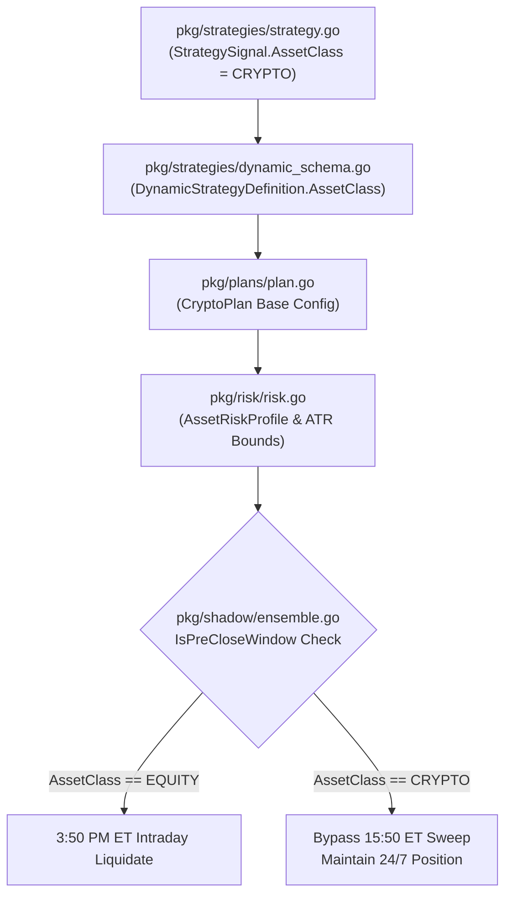

# Epic: Crypto Strategy Interface & Risk Boundary

## 1. Executive Summary & Architectural System of Record

The **Crypto Strategy Interface & Risk Boundary** epic establishes structural isolation for cryptocurrency strategies within the Gelt quantitative trading platform. Cryptocurrency markets operate 24/7/365 and exhibit higher volatility profiles compared to traditional US equity markets. Existing equity strategies in Gelt are subject to a mandatory **3:50 PM ET pre-close liquidation sweep** to prevent holding fractional/dollar-based positions overnight across US market closes. 

To enable seamless, risk-controlled crypto trading alongside traditional equities and options, crypto strategies and trading plans must explicitly declare their asset class (`CRYPTO`), bypass intraday liquidation gates, and employ wider ATR-calibrated risk parameters.

---

## 2. Linear Tracking & Ticket Specifications

- **Epic Project**: [Epic: Crypto Strategy Interface & Risk Boundary](https://linear.app/geltagentictrading/project/epic-crypto-strategy-interface-and-risk-boundary-7aa453c5009e) (`ID: 40554219-46ec-461e-957c-61d94d3658c6`)
- **Team**: OUR SERVER (`ZAR`)

### Ticket 1: Strategy Asset Class Interface
- **Linear URL**: [ZAR-63](https://linear.app/geltagentictrading/issue/ZAR-63/ticket-1-strategy-asset-class-interface)
- **Team / Project**: Gelt Engineering / Epic: Crypto Strategy Interface & Risk Boundary
- **Blockers / Dependencies**: None
- **Scope**: `pkg/strategies/strategy.go`, `pkg/strategies/dynamic_schema.go`
- **Objective**: Update the `StrategySignal` struct and `DynamicStrategyDefinition` schema to include an `AssetClass` type/enum (supporting `EQUITY`, `CRYPTO`, `OPTIONS`). Ensure existing strategies default to `EQUITY`.
- **Acceptance Criteria**:
  - Verify unit tests pass demonstrating `StrategySignal` correctly parsing and passing the new `AssetClass` tag.
  - Verify existing `EQUITY` strategies remain unaffected.

### Ticket 2: Crypto Risk Governance & Plan Isolation
- **Linear URL**: [ZAR-64](https://linear.app/geltagentictrading/issue/ZAR-64/ticket-2-crypto-risk-governance-and-plan-isolation)
- **Team / Project**: Gelt Engineering / Epic: Crypto Strategy Interface & Risk Boundary
- **Blockers / Dependencies**: [ZAR-63](https://linear.app/geltagentictrading/issue/ZAR-63/ticket-1-strategy-asset-class-interface) (Ticket 1: Strategy Asset Class Interface)
- **Scope**: Execution engine / Plan registry (`pkg/plans/`, `pkg/risk/`, `pkg/shadow/`)
- **Objective**: Implement a `CryptoPlan` base configuration. This plan MUST completely bypass the 3:50 PM ET intraday liquidation sweep rule. It must also implement wider parameter bounds for the dynamic ATR trailing stop to account for crypto volatility.
- **Acceptance Criteria**:
  - Verify a dedicated unit test proves that a position tagged as `CRYPTO` is NOT liquidated at 15:50 ET.
  - Verify `go test -race ./...` passes to ensure no thread collisions between equity sweeps and crypto holds.

---

## 3. Deep Codebase Integration & Technical Architecture



### Component Details

1. **Asset Class Schema Expansion (`pkg/strategies`)**:
   - Introduce `AssetClass` string enum:
     ```go
     type AssetClass string

     const (
         AssetClassEquity  AssetClass = "EQUITY"
         AssetClassCrypto  AssetClass = "CRYPTO"
         AssetClassOptions AssetClass = "OPTIONS"
     )
     ```
   - Extend `StrategySignal` struct:
     ```go
     type StrategySignal struct {
         StrategyName string     `json:"strategy_name"`
         Symbol       string     `json:"symbol"`
         Signal       SignalType `json:"signal"`
         AssetClass   AssetClass `json:"asset_class"` // EQUITY (default), CRYPTO, OPTIONS
         Score        float64    `json:"score"`
         StopLossPct  float64    `json:"stop_loss_pct"`
         TargetPct    float64    `json:"target_pct"`
         Rationale    string     `json:"rationale"`
         AgentPrompt  string     `json:"agent_prompt,omitempty"`
         Timestamp    time.Time  `json:"timestamp"`
     }
     ```
   - Extend `DynamicStrategyDefinition` schema:
     ```go
     type DynamicStrategyDefinition struct {
         Name        string          `json:"name"`
         Description string          `json:"description"`
         AssetClass  AssetClass      `json:"asset_class,omitempty"`
         Conditions  []Condition     `json:"conditions"`
         LogicalOp   LogicalOperator `json:"logical_op"`
         Signal      SignalType      `json:"signal"`
     }
     ```

2. **Crypto Governance & Pre-Close Gate Isolation (`pkg/plans`, `pkg/risk`, `pkg/shadow`)**:
   - `CryptoPlan` base plan configuration created in `pkg/plans/crypto_plan.go` inheriting base evaluation capabilities while specifying `AssetClassCrypto`.
   - `pkg/risk/risk.go` updated to export asset risk profiles with expanded ATR trailing stop loss and target bounds for cryptocurrencies (e.g. BTC/ETH trailing stops at 3.5%–5.0%).
   - `pkg/shadow/ensemble.go` pre-close sweep logic updated:
     ```go
     if risk.IsPreCloseWindow(evalTime) {
         for symbol, pos := range positions {
             if pos.AssetClass == strategies.AssetClassCrypto {
                 continue // Crypto positions bypass 3:50 PM ET pre-close sweep
             }
             // Liquidate equity positions before 16:00 ET close
         }
     }
     ```

---

## 4. Verification & Testing Protocol

- **Interface Verification**:
  ```bash
  go test ./pkg/strategies/... -v
  ```
- **Pre-Close Sweep Isolation Verification**:
  ```bash
  go test ./pkg/plans/... ./pkg/shadow/... -v -run TestCryptoPreCloseBypass
  ```
- **Concurrency & Race Detection**:
  ```bash
  go test -race ./...
  ```
