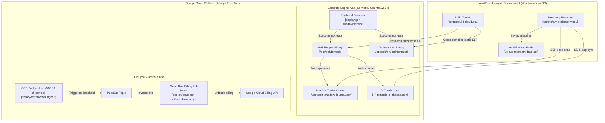
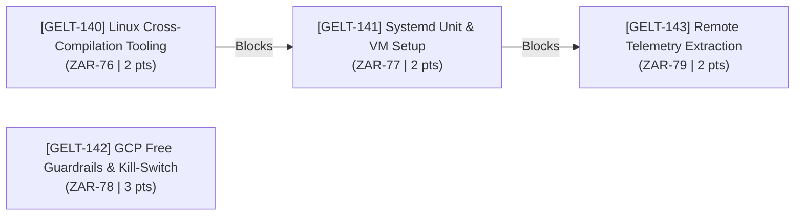

# [EPIC] GCP e2-micro 24/7 Cloud Deployment & Cross-Compilation Pipeline

## 1. Executive Summary

Configures Gelt for continuous 24/7 cloud execution on a Google Cloud Platform (GCP) Compute Engine `e2-micro` virtual machine ($0/month Always Free tier). Sets up automated Linux cross-compilation scripts (`CGO_ENABLED=0 GOOS=linux GOARCH=amd64`), systemd service daemons (`gelt-shadow.service`), GCP budget kill-switch guardrails, and secure remote telemetry extraction routines (`scp`/`rsync`) without disrupting local Windows testing workflows.

---

## 2. Infrastructure & Compute Architecture

### Target Cloud Environment Specs (GCP Always Free Tier)
- **Machine Type:** Compute Engine `e2-micro` (2 vCPUs, 1 GB RAM)
- **Region:** `us-central1` (Iowa), `us-east1` (South Carolina), or `us-west1` (Oregon)
- **Storage:** 30 GB Standard Persistent Disk (`pd-standard`) with Ubuntu 22.04 LTS
- **Network Cost:** Included within standard 1 GB outbound egress budget
- **Monthly Cost Target:** **$0.00 / month**

### Architecture Diagram

---

## 3. Metacognitive Dependency Map & Ticket Sequencing

---

## 4. Engineering Ticket Manifest

### 🎫 Ticket 1: [GELT-140] Linux Cross-Compilation Tooling & Multi-Target Build Scripts
- **Linear Key:** [`ZAR-76`](https://linear.app/geltagentictrading/issue/ZAR-76/gelt-140-linux-cross-compilation-tooling-and-multi-target-build)
- **Scope:** DevOps / Build Tooling
- **Priority:** High (P2)
- **Estimate:** 2 Points
- **Blockers:** None
- **Target Files:** `scripts/build-cloud.ps1`, `scripts/build-cloud.sh`, `.gitignore`

#### Technical Requirement & Implementation Details
Develop cross-platform shell scripts (`scripts/build-cloud.ps1` for PowerShell and `scripts/build-cloud.sh` for Bash) that compile static, CGO-disabled Linux x86_64 ELF binaries for both `cmd/gelt` and `cmd/orchestrator`.
- Enforce flags `CGO_ENABLED=0 GOOS=linux GOARCH=amd64`.
- Strip debug symbols and symbols table via `-ldflags="-s -w"`.
- Output binaries to `bin/linux/gelt` and `bin/linux/orchestrator`.
- Add `bin/` pattern to `.gitignore` to prevent committing build artifacts.

#### Acceptance Criteria
- [ ] Running `scripts/build-cloud.ps1` produces static Linux ELF binaries in `bin/linux/gelt` and `bin/linux/orchestrator`.
- [ ] Binaries execute cleanly inside a standard Ubuntu 22.04 LTS / Debian Linux Docker container without CGO/glibc missing dependency errors.
- [ ] Build artifacts in `bin/` are verified as ignored in `.gitignore`.

---

### 🎫 Ticket 2: [GELT-141] Systemd Unit Configuration & Process Daemonization
- **Linear Key:** [`ZAR-77`](https://linear.app/geltagentictrading/issue/ZAR-77/gelt-141-systemd-unit-configuration-and-process-daemonization)
- **Scope:** Infrastructure / Linux Operations
- **Priority:** High (P2)
- **Estimate:** 2 Points
- **Blockers:** Blocked by GELT-140 (`ZAR-76`)
- **Target Files:** `deploy/gelt-shadow.service`, `deploy/setup-vm.sh`

#### Technical Requirement & Implementation Details
Create the production systemd unit specification (`deploy/gelt-shadow.service`) and VM provisioning script (`deploy/setup-vm.sh`) for 24/7 background execution.
- Create an unprivileged system user `gelt` with home directory `/home/gelt`.
- Configure daemon auto-restart behavior (`Restart=always`, `RestartSec=10`).
- Route standard logs directly into systemd `journald` (`StandardOutput=journal`, `StandardError=journal`).
- Inject environment hooks `GELT_ENV=agent` and working directory `/opt/gelt`.

#### Acceptance Criteria
- [ ] `deploy/gelt-shadow.service` passes `systemd-analyze verify` without syntax errors.
- [ ] `deploy/setup-vm.sh` provisions the configured service directories, creates a dedicated unprivileged service user, and enables the service daemon.
- [ ] Simulated process crash triggers an automatic systemd restart after 10 seconds.

---

### 🎫 Ticket 3: [GELT-142] GCP Always Free Guardrails & Billing Kill-Switch Trigger
- **Linear Key:** [`ZAR-78`](https://linear.app/geltagentictrading/issue/ZAR-78/gelt-142-gcp-always-free-guardrails-and-billing-kill-switch-trigger)
- **Scope:** Infrastructure / Cloud Security / FinOps
- **Priority:** High (P2)
- **Estimate:** 3 Points
- **Blockers:** None
- **Target Files:** `deploy/cloud-run-killswitch/main.py`, `deploy/terraform/budget.tf`

#### Technical Requirement & Implementation Details
Implement declarative billing safety infrastructure to guarantee $0 cost bounds on GCP.
- Configure Terraform IaC (`deploy/terraform/budget.tf`) defining a $10.00 monthly GCP budget alert rule.
- Connect budget alerts to a Pub/Sub notification channel.
- Implement a Python Cloud Run function (`deploy/cloud-run-killswitch/main.py`) that consumes Pub/Sub budget alerts and calls `google-api-python-client` billing API (`projects().updateBillingInfo`) to unbind project billing automatically if spend reaches 100%.

#### Acceptance Criteria
- [ ] GCP Budget alert rule at 100% threshold configured via IaC/scripting.
- [ ] Cloud Run function successfully processes mock Pub/Sub budget payloads and calls the Google Cloud Billing API to unbind project billing.
- [ ] Deployment checklist verifies VM parameters match GCP Always Free specs (`e2-micro`, `us-central1`/`us-east1`/`us-west1`, 30 GB standard persistent disk).

---

### 🎫 Ticket 4: [GELT-143] Remote Shadow Journal Sync & Diagnostic Extraction Tooling
- **Linear Key:** [`ZAR-79`](https://linear.app/geltagentictrading/issue/ZAR-79/gelt-143-remote-shadow-journal-sync-and-diagnostic-extraction-tooling)
- **Scope:** DevOps / Telemetry
- **Priority:** Medium (P3)
- **Estimate:** 2 Points
- **Blockers:** Blocked by GELT-141 (`ZAR-77`)
- **Target Files:** `scripts/sync-telemetry.ps1`, `scripts/sync-telemetry.sh`

#### Technical Requirement & Implementation Details
Build remote synchronization scripts (`scripts/sync-telemetry.ps1` and `scripts/sync-telemetry.sh`) to safely extract runtime telemetry from the cloud VM to local operator workstations.
- Securely connect over SSH using specified identity keys.
- Pull persistent journals (`~/.gelt/gelt_shadow_journal.json`), AI thesis logs (`gelt_ai_theses.json`), and markdown executive reports.
- Store local snapshots under `./cloud-telemetry-backup/` timestamped folders without mutating remote VM state or corrupting JSON schema formatting.

#### Acceptance Criteria
- [ ] Running `scripts/sync-telemetry.ps1` securely fetches remote `.json` and `.md` log artifacts into a local `./cloud-telemetry-backup/` directory.
- [ ] Sync script verifies SSH key authentication and handles file permission checks gracefully.
- [ ] Verification test confirms local PC runs can read synced cloud shadow journals without schema corruption.

---

## 5. Summary Matrix & Total Estimates

| Ticket ID | Title | Scope | Priority | Points | Blockers | Target Linear Issue |
| :--- | :--- | :--- | :---: | :---: | :--- | :--- |
| **GELT-140** | Linux Cross-Compilation Tooling & Multi-Target Build Scripts | DevOps / Build Tooling | P2 | 2 | None | [`ZAR-76`](https://linear.app/geltagentictrading/issue/ZAR-76/gelt-140-linux-cross-compilation-tooling-and-multi-target-build) |
| **GELT-141** | Systemd Unit Configuration & Process Daemonization | Infrastructure / Operations | P2 | 2 | GELT-140 | [`ZAR-77`](https://linear.app/geltagentictrading/issue/ZAR-77/gelt-141-systemd-unit-configuration-and-process-daemonization) |
| **GELT-142** | GCP Always Free Guardrails & Billing Kill-Switch Trigger | FinOps / Security | P2 | 3 | None | [`ZAR-78`](https://linear.app/geltagentictrading/issue/ZAR-78/gelt-142-gcp-always-free-guardrails-and-billing-kill-switch-trigger) |
| **GELT-143** | Remote Shadow Journal Sync & Diagnostic Extraction Tooling | DevOps / Telemetry | P3 | 2 | GELT-141 | [`ZAR-79`](https://linear.app/geltagentictrading/issue/ZAR-79/gelt-143-remote-shadow-journal-sync-and-diagnostic-extraction-tooling) |

**Total Epic Story Points:** 9 Points
