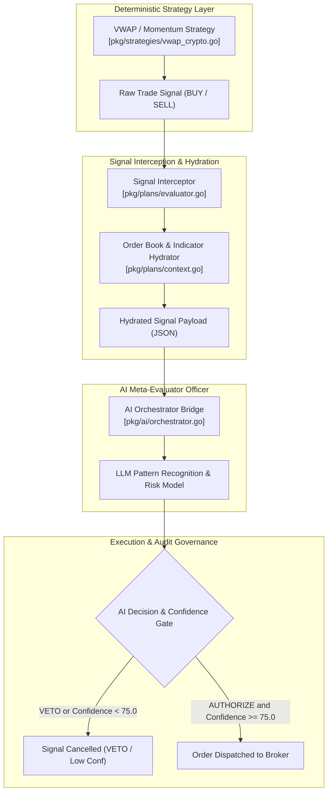

# [EPIC] LLM Meta-Evaluator Risk Officer

## 1. Executive Summary

Introduce an interception layer where deterministic strategy signals are passed to an LLM for final pattern recognition and authorization prior to execution. When a deterministic strategy like `VWAP_Crypto` fires a Buy signal, Gelt intercepts it and sends the hydrated chart/order book context to the AI orchestrator for final authorization before execution.

---

## 2. Architecture & Interception Flow

---

## 3. Strict Linear Specification Output

[SCHEMA_START]
Epic Title: LLM Meta-Evaluator Risk Officer
Objective: Introduce an interception layer where deterministic strategy signals are passed to an LLM for final pattern recognition and authorization prior to execution.

Ticket 1:
- Title: Signal Interception & Context Hydration Layer
- Linear Key: ZAR-82 (https://linear.app/geltagentictrading/issue/ZAR-82/gelt-152-signal-interception-and-context-hydration-layer)
- Scope: pkg/plans/evaluator.go
- Description: Build an interceptor that catches Buy/Sell signals from active strategies and packages the current order book, price action, and indicator state into a hydrated context payload for the LLM.
- Acceptance Criteria:
  1. `go test -race ./pkg/plans/...` passes when deterministic signals trigger `InterceptSignal()` and format a valid JSON payload containing order book depth, RSI/VWAP indicators, and active strategy state.
  2. Unit tests verify signal execution pauses cleanly while awaiting LLM context hydration.

Ticket 2:
- Title: AI Authorization Router & Overrides
- Linear Key: ZAR-83 (https://linear.app/geltagentictrading/issue/ZAR-83/gelt-153-ai-authorization-router-and-overrides)
- Scope: pkg/ai/orchestrator.go
- Description: Route the hydrated context to the AI model. If the AI returns a confidence score below a threshold or detects a false positive setup, override and cancel the pending signal.
- Acceptance Criteria:
  1. `go test -race ./cmd/orchestrator/...` passes when an AI confidence score < 75.0 or explicit VETO decision successfully overrides and cancels a pending Buy signal.
  2. Integration tests confirm high-conviction AI responses (score >= 75.0) authorize signal execution with audit logging.
[SCHEMA_END]

---

## 4. Engineering Ticket Breakdown

### 🎫 Ticket 1: [GELT-152] Signal Interception & Context Hydration Layer
- **Linear Key:** [`ZAR-82`](https://linear.app/geltagentictrading/issue/ZAR-82/gelt-152-signal-interception-and-context-hydration-layer)
- **Scope:** `pkg/plans/evaluator.go`
- **Priority:** High (P2)
- **Estimate:** 2 Points
- **Blockers:** None

#### Description
Build an interceptor that catches Buy/Sell signals from active strategies and packages the current order book, price action, and indicator state into a hydrated context payload for the LLM.

#### Acceptance Criteria
1. `go test -race ./pkg/plans/...` passes when deterministic signals trigger `InterceptSignal()` and format a valid JSON payload containing order book depth, RSI/VWAP indicators, and active strategy state.
2. Unit tests verify signal execution pauses cleanly while awaiting LLM context hydration.

---

### 🎫 Ticket 2: [GELT-153] AI Authorization Router & Overrides
- **Linear Key:** [`ZAR-83`](https://linear.app/geltagentictrading/issue/ZAR-83/gelt-153-ai-authorization-router-and-overrides)
- **Scope:** `pkg/ai/orchestrator.go` (and `cmd/orchestrator/bridge.go`)
- **Priority:** High (P2)
- **Estimate:** 2 Points
- **Blockers:** Blocked by GELT-152 (`ZAR-82`)

#### Description
Route the hydrated context to the AI model. If the AI returns a confidence score below a threshold or detects a false positive setup, override and cancel the pending signal.

#### Acceptance Criteria
1. `go test -race ./cmd/orchestrator/...` passes when an AI confidence score < 75.0 or explicit VETO decision successfully overrides and cancels a pending Buy signal.
2. Integration tests confirm high-conviction AI responses (score >= 75.0) authorize signal execution with audit logging.
