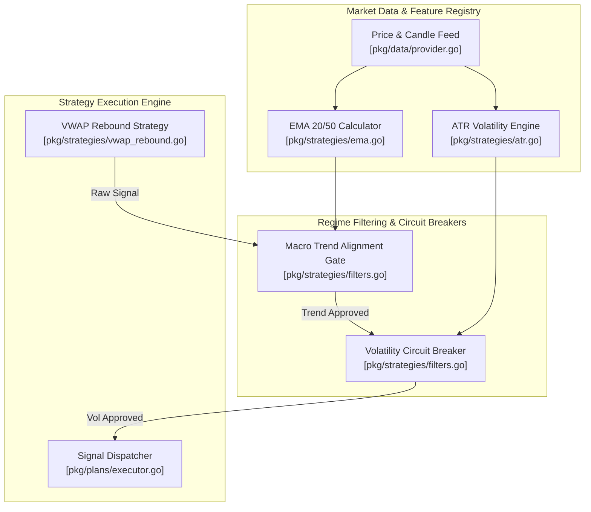

# [EPIC] Macro-Regime Signal Filtering & Volatility Circuit Breakers

## 1. Executive Summary

Implement trend (EMA) and volatility (ATR/VIX) gates to prevent deterministic strategies from trading in unfavorable market regimes. Deterministic strategies (like `VWAPRebound`) will be muted or blocked if the macro trend is negative (price below 20/50 EMA) or if micro-volatility (ATR) drops too low, indicating chop.

---

## 2. Architecture & Component Topology

---

## 3. Strict Linear Specification Output

[SCHEMA_START]
Epic Title: Macro-Regime Signal Filtering & Volatility Circuit Breakers
Objective: Implement trend (EMA) and volatility (ATR/VIX) gates to prevent deterministic strategies from trading in unfavorable market regimes.

Ticket 1:
- Title: Macro Trend Alignment Gate (EMA 20/50)
- Linear Key: ZAR-80 (https://linear.app/geltagentictrading/issue/ZAR-80/gelt-150-macro-trend-alignment-gate-ema-2050)
- Scope: pkg/strategies/ and pkg/plans/
- Description: Create a filter that evaluates the underlying asset's price relative to its 20 and 50-period EMA. Reject long signals if the asset is in a downtrend.
- Acceptance Criteria:
  1. Verify `go test -race ./pkg/strategies/...` passes when EMA filter rejects a valid VWAP buy signal during a downtrend (price < 20 EMA & 20 EMA < 50 EMA).
  2. Integration tests in `pkg/plans/...` verify long signals pass when price > 20 EMA & 20 EMA > 50 EMA.

Ticket 2:
- Title: Volatility Circuit Breakers (ATR Chop Filter)
- Linear Key: ZAR-81 (https://linear.app/geltagentictrading/issue/ZAR-81/gelt-151-volatility-circuit-breakers-atr-chop-filter)
- Scope: pkg/strategies/filters.go
- Description: Implement an ATR-based volatility check. If current ATR drops below a configurable baseline threshold, pause mean-reversion entries until volatility expands.
- Acceptance Criteria:
  1. Verify `go test -race ./pkg/strategies/...` passes when low ATR conditions trigger the chop filter and block mean-reversion buy signals.
  2. Configurable ATR threshold defaults to 1.5% of asset price and successfully allows trades when ATR expands above threshold.
[SCHEMA_END]

---

## 4. Engineering Ticket Details

### 🎫 Ticket 1: [GELT-150] Macro Trend Alignment Gate (EMA 20/50)
- **Linear Key:** [`ZAR-80`](https://linear.app/geltagentictrading/issue/ZAR-80/gelt-150-macro-trend-alignment-gate-ema-2050)
- **Scope:** `pkg/strategies/` and `pkg/plans/`
- **Priority:** High (P2)
- **Estimate:** 2 Points
- **Blockers:** None

#### Description
Create a filter that evaluates the underlying asset's price relative to its 20 and 50-period EMA. Reject long signals if the asset is in a downtrend.

#### Acceptance Criteria
1. Verify `go test -race ./pkg/strategies/...` passes when EMA filter rejects a valid VWAP buy signal during a downtrend ($Price < EMA_{20}$ and $EMA_{20} < EMA_{50}$).
2. Integration tests in `pkg/plans/...` verify long signals pass when price > 20 EMA and 20 EMA > 50 EMA.

---

### 🎫 Ticket 2: [GELT-151] Volatility Circuit Breakers (ATR Chop Filter)
- **Linear Key:** [`ZAR-81`](https://linear.app/geltagentictrading/issue/ZAR-81/gelt-151-volatility-circuit-breakers-atr-chop-filter)
- **Scope:** `pkg/strategies/filters.go`
- **Priority:** High (P2)
- **Estimate:** 2 Points
- **Blockers:** Blocked by GELT-150 (`ZAR-80`)

#### Description
Implement an ATR-based volatility check. If current ATR drops below a configurable baseline threshold, pause mean-reversion entries until volatility expands.

#### Acceptance Criteria
1. Verify `go test -race ./pkg/strategies/...` passes when low ATR conditions trigger the chop filter and block mean-reversion buy signals.
2. Configurable ATR threshold defaults to 1.5% of asset price and successfully allows trades when ATR expands above threshold.
