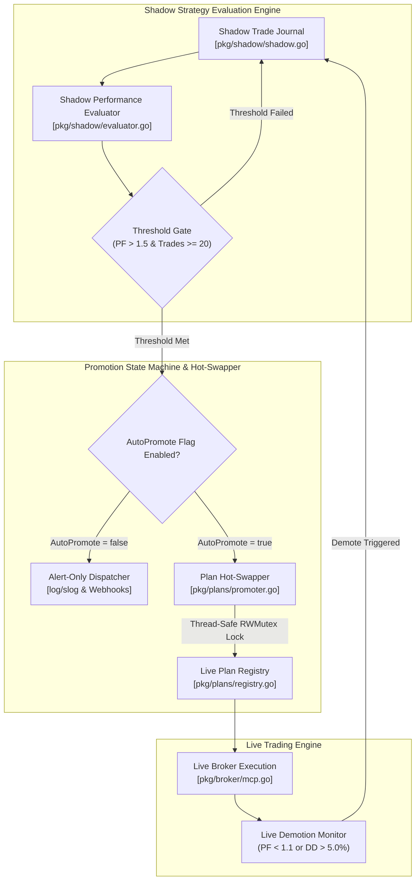

# [EPIC] Shadow-to-Live Auto-Promotion Engine

## 1. Executive Summary

Enable Gelt to autonomously hot-swap trading plans mid-session by promoting paper strategies that exceed strict quantitative thresholds. Gelt needs the ability to automatically promote a shadow strategy to live capital if it hits strict statistical thresholds (e.g., Profit Factor > 1.5 over 20 closed trades). It must also demote strategies back to shadow if performance decays.

---

## 2. Architecture & State Machine Topology

---

## 3. Strict Linear Specification Output

[SCHEMA_START]
Epic Title: Shadow-to-Live Auto-Promotion Engine
Objective: Enable Gelt to autonomously hot-swap trading plans mid-session by promoting paper strategies that exceed strict quantitative thresholds.

Ticket 1:
- Title: Shadow Performance Evaluator & Threshold Gate
- Linear Key: ZAR-84 (https://linear.app/geltagentictrading/issue/ZAR-84/gelt-154-shadow-performance-evaluator-and-threshold-gate)
- Scope: pkg/shadow/evaluator.go
- Description: Build an evaluator that continuously polls the PnL, Win Rate, and Profit Factor of running shadow strategies against configurable promotion thresholds.
- Acceptance Criteria:
  1. Verify `go test -race ./pkg/shadow/...` confirms threshold gate triggers when shadow Profit Factor > 1.5 and closed trades >= 20.
  2. Demotion threshold gate correctly flags live strategies for demotion back to shadow mode when Profit Factor drops below 1.1 or Max Drawdown exceeds 5.0%.

Ticket 2:
- Title: Dynamic Mid-Day Promotion & Plan Hot-Swapper
- Linear Key: ZAR-85 (https://linear.app/geltagentictrading/issue/ZAR-85/gelt-155-dynamic-mid-day-promotion-and-plan-hot-swapper)
- Scope: pkg/plans/promoter.go
- Description: Create the state-machine logic to safely promote a qualifying shadow plan to the live engine mid-session without dropping active ticks or colliding with open positions. Add safety flags to toggle auto-promotion vs alert-only mode.
- Acceptance Criteria:
  1. `go test -race ./pkg/plans/...` passes during mid-session promotion without dropped tick market data or duplicate position allocations.
  2. Alert-only mode (`AutoPromote=false`) logs promotion proposals to structured `log/slog` output and triggers webhook alerts without mutating live engine state.
[SCHEMA_END]

---

## 4. Engineering Ticket Breakdown

### 🎫 Ticket 1: [GELT-154] Shadow Performance Evaluator & Threshold Gate
- **Linear Key:** [`ZAR-84`](https://linear.app/geltagentictrading/issue/ZAR-84/gelt-154-shadow-performance-evaluator-and-threshold-gate)
- **Scope:** `pkg/shadow/evaluator.go`
- **Priority:** High (P2)
- **Estimate:** 2 Points
- **Blockers:** None

#### Description
Build an evaluator that continuously polls the PnL, Win Rate, and Profit Factor of running shadow strategies against configurable promotion thresholds.

#### Acceptance Criteria
1. Verify `go test -race ./pkg/shadow/...` confirms threshold gate triggers when shadow Profit Factor > 1.5 and closed trades >= 20.
2. Demotion threshold gate correctly flags live strategies for demotion back to shadow mode when Profit Factor drops below 1.1 or Max Drawdown exceeds 5.0%.

---

### 🎫 Ticket 2: [GELT-155] Dynamic Mid-Day Promotion & Plan Hot-Swapper
- **Linear Key:** [`ZAR-85`](https://linear.app/geltagentictrading/issue/ZAR-85/gelt-155-dynamic-mid-day-promotion-and-plan-hot-swapper)
- **Scope:** `pkg/plans/promoter.go`
- **Priority:** High (P2)
- **Estimate:** 2 Points
- **Blockers:** Blocked by GELT-154 (`ZAR-84`)

#### Description
Create the state-machine logic to safely promote a qualifying shadow plan to the live engine mid-session without dropping active ticks or colliding with open positions. Add safety flags to toggle auto-promotion vs alert-only mode.

#### Acceptance Criteria
1. `go test -race ./pkg/plans/...` passes during mid-session promotion without dropped tick market data or duplicate position allocations.
2. Alert-only mode (`AutoPromote=false`) logs promotion proposals to structured `log/slog` output and triggers webhook alerts without mutating live engine state.
