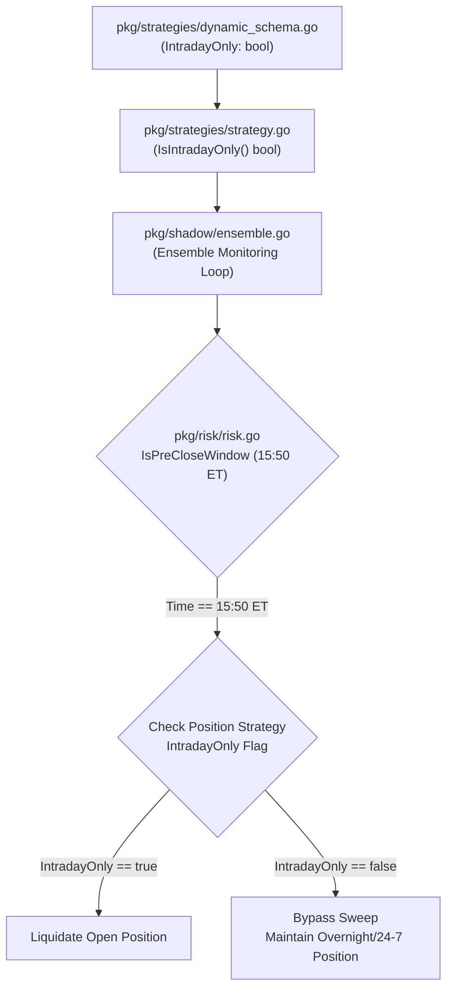

# Epic: Strategy-Level Execution Horizon & Liquidation

## 1. Executive Summary & Architectural System of Record

This specification details the architectural pivot from a hardcoded global 3:50 PM ET pre-close liquidation sweep to a **decentralized, strategy-level execution horizon model**. 

Under the previous model, Gelt enforced a blanket pre-close liquidation sweep across all open positions at 3:50 PM ET to manage US equity market close risk. However, as Gelt expands to support multi-day Equity swing trading, Options strategies, and 24/7 Cryptocurrency trading, a single global sweep is insufficient and restrictive.

By embedding an `IntradayOnly` boolean parameter directly into the `Strategy` contract and `DynamicStrategyDefinition` schema, each strategy dictates its own liquidation lifecycle:
- **Intraday Strategies (`IntradayOnly: true`)**: Liquidated automatically during the 3:50 PM ET pre-close window.
- **Swing & Crypto Strategies (`IntradayOnly: false`)**: Bypass the 3:50 PM ET pre-close sweep and hold positions across market sessions or 24/7 cycles.

---

## 2. Linear Tracking & Ticket Specifications

- **Epic Project**: [Epic: Strategy-Level Execution Horizon & Liquidation](https://linear.app/geltagentictrading/project/epic-strategy-level-execution-horizon-and-liquidation-7aa453c5009e) (`ID: 40554219-46ec-461e-957c-61d94d3658c6`)
- **Team**: OUR SERVER (`ZAR`)

### Ticket 1: Strategy Horizon Schema Update
- **Linear URL**: [ZAR-65](https://linear.app/geltagentictrading/issue/ZAR-65/ticket-1-strategy-horizon-schema-update)
- **Team / Project**: Gelt Engineering / Epic: Strategy-Level Execution Horizon & Liquidation
- **Blockers / Dependencies**: None
- **Scope**: `pkg/strategies/strategy.go`, `pkg/strategies/dynamic_schema.go`
- **Objective**: Update the `DynamicStrategyDefinition` schema and the `Strategy` interface to include an `IntradayOnly` boolean (defaulting to true).
- **Acceptance Criteria**:
  - Verify unit tests pass demonstrating `DynamicStrategyDefinition` correctly parsing the `IntradayOnly` flag.
  - Verify existing strategies default to `IntradayOnly: true`.

### Ticket 2: Decentralized Engine Liquidation Sweep
- **Linear URL**: [ZAR-66](https://linear.app/geltagentictrading/issue/ZAR-66/ticket-2-decentralized-engine-liquidation-sweep)
- **Team / Project**: Gelt Engineering / Epic: Strategy-Level Execution Horizon & Liquidation
- **Blockers / Dependencies**: [ZAR-65](https://linear.app/geltagentictrading/issue/ZAR-65/ticket-1-strategy-horizon-schema-update) (Ticket 1: Strategy Horizon Schema Update)
- **Scope**: Execution engine (`pkg/engine` or equivalent / `pkg/shadow/ensemble.go` / `pkg/plans/` / `pkg/risk/`)
- **Objective**: Remove the hardcoded global 3:50 PM liquidation sweep. Update the engine's position monitoring loop so that at 3:50 PM ET, it ONLY liquidates open positions that were generated by a strategy where `IntradayOnly == true`. Positions tagged `IntradayOnly == false` MUST bypass this sweep.
- **Acceptance Criteria**:
  - Verify a dedicated unit test proves that a mock position with `IntradayOnly == false` survives the 15:50 ET system clock tick.
  - Verify a mock position with `IntradayOnly == true` is correctly flagged for liquidation at 15:50 ET.

---

## 3. Deep Codebase Integration & Technical Architecture



### Component Technical Details

1. **Schema & Strategy Interface Update (`pkg/strategies`)**:
   - Update `DynamicStrategyDefinition`:
     ```go
     type DynamicStrategyDefinition struct {
         Name         string          `json:"name"`
         Description  string          `json:"description"`
         IntradayOnly *bool           `json:"intraday_only,omitempty"` // Default: true
         Conditions   []Condition     `json:"conditions"`
         LogicalOp    LogicalOperator `json:"logical_op"`
         Signal       SignalType      `json:"signal"`
     }
     ```
   - Update `Strategy` interface and default implementations:
     ```go
     type Strategy interface {
         Name() string
         Description() string
         IntradayOnly() bool
         Init(registry *data.FeatureRegistry) error
         CapitalRequirement() float64
         Evaluate(ctx context.Context, evalTime time.Time, symbol string, closes []float64, volumes []float64) (StrategySignal, error)
     }
     ```

2. **Decentralized Sweep Logic (`pkg/shadow/ensemble.go` / `pkg/risk/risk.go`)**:
   - Refactor pre-close liquidation loop to query strategy horizon attributes per position:
     ```go
     if risk.IsPreCloseWindow(evalTime) {
         for symbol, pos := range activePositions {
             if !pos.Strategy.IntradayOnly() {
                 slog.Info("Position bypassing 15:50 sweep due to multi-day horizon", "symbol", symbol, "strategy", pos.Strategy.Name())
                 continue
             }
             // Liquidate intraday-only position
             e.liquidatePosition(symbol, "PRE-CLOSE SWEEP (IntradayOnly)")
         }
     }
     ```

---

## 4. Verification & Testing Protocol

- **Schema & Horizon Unit Verification**:
  ```bash
  go test ./pkg/strategies/... -v
  ```
- **Decentralized Sweep Integration Test**:
  ```bash
  go test ./pkg/plans/... ./pkg/shadow/... -v -run TestDecentralizedPreCloseSweep
  ```
- **Thread Safety & Race Condition Check**:
  ```bash
  go test -race ./...
  ```
