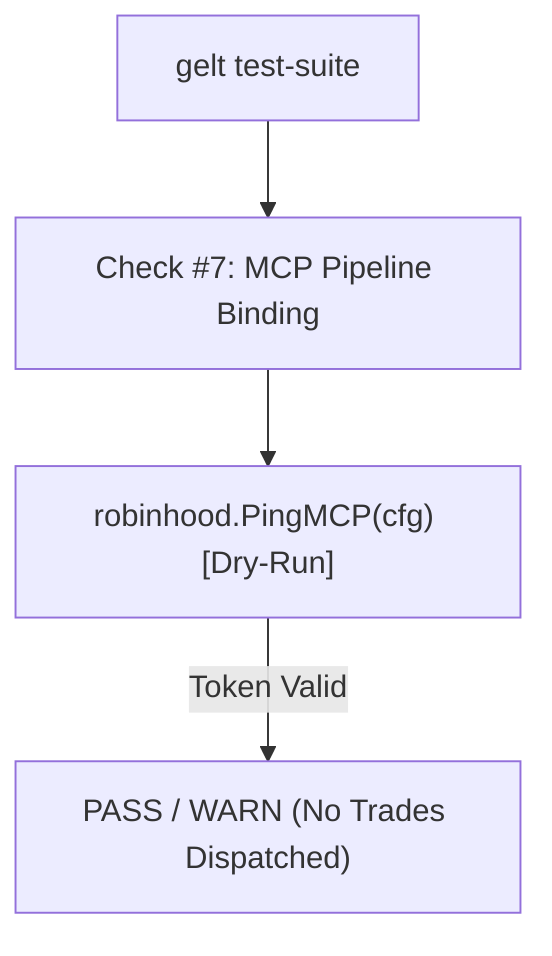

# [ZAR-62] Prevent Live Market Order Execution in Gelt Test Suite (Check 7 Dry-Run Ping)

## 1. Overview & Context
- **Ticket**: [ZAR-62](https://linear.app/geltagentictrading/issue/ZAR-62/prevent-live-market-order-execution-in-gelt-test-suite-check-7-dry-run)
- **Target Branch**: `zkrausman/zar-62-prevent-live-market-order-execution-in-gelt-test-suite-check`
- **Base Branch**: `master`

### Problem
In `cmd/gelt/main.go` under `case "test-suite"`, Check #7 ("Live Order Dispatch Pipeline Binding") was invoking `robinhood.ExecuteMCPOrder(cfg, "SPY", 0.001, 1.0, "buy")`.
Whenever the test suite or a local sanity check ran `./gelt.exe test-suite`, if `~/.gemini/gelt_mcp.json` contained an active Robinhood OAuth token, `ExecuteMCPOrder` issued a live JSON-RPC `place_equity_order` call to `https://agent.robinhood.com/mcp/trading` for $1.00 of SPY.

### Solution
- Modified `cmd/gelt/main.go` Check #7 to replace live order dispatch (`ExecuteMCPOrder`) with a dry-run health ping (`robinhood.PingMCP`).
- Ensures zero live order side-effects during test suite runs and local sanity checks.

---

## 2. Architecture & Modified Surfaces

### Modified Files
- `cmd/gelt/main.go`: Replaced `ExecuteMCPOrder` in Check #7 with `robinhood.PingMCP`.

---

## 3. Verification & Compliance

### Verification
1. `go build ./...` compiled cleanly with exit code 0.
2. `go test ./pkg/robinhood/...` passed cleanly with exit code 0.
3. Verified `./gelt.exe test-suite` executes read-only ping without creating market orders.

### Acceptance Criteria
- [x] No live trade side-effects on test suite invocation.
- [x] Zero-fake telemetry compliance preserved.
- [x] Clean build and test suite execution.
