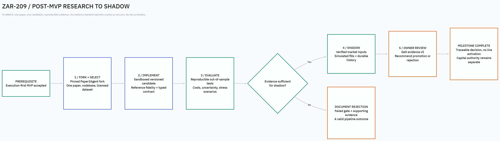
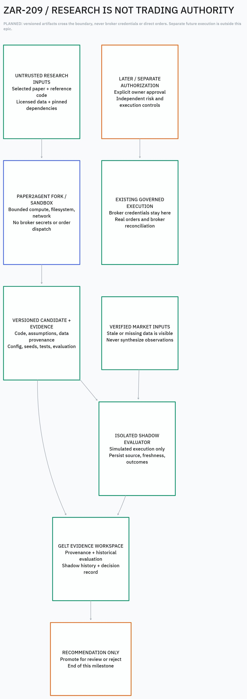

# ZAR-209: Post-MVP Research-to-Shadow Pipeline

## Executive decision

The first post-MVP milestone is **one selected paper → one traceable strategy candidate → reproducible evaluation → shadow observation → an evidence-backed recommendation**. A well-supported rejection is a successful pipeline outcome. Profitability is not guaranteed.

Build on a dedicated fork of [jmiao24/Paper2Agent](https://github.com/jmiao24/Paper2Agent). Keep research generation and evaluation separate from permission to trade. The epic is tracked in [Linear ZAR-209](https://linear.app/geltagentictrading/issue/ZAR-209/epic-post-mvp-research-to-shadow-pipeline-paper2agent-fork).

**This change delivers documentation and diagrams only.** No fork, strategy implementation, repository reset, account connection, live activation, or capital allocation is performed or authorized by merging it.

## Dependency: execution-first MVP

Begin implementation after acceptance of the Gelt MVP: owner-operated broker connection, preview and exact-order confirmation, controlled submission, cancellation, broker reconciliation, durable execution history, and restart recovery.

The proposed v2 workspace is OpenTerminal-derived. This document does not replace the existing product charter, select the final execution runtime, or retire historical roadmap items. The MVP dependency is a sequencing gate; an explicit issue dependency must be added when the accepted MVP tracking item is available.

## Scope and workstreams

| Workstream | Required output |
| --- | --- |
| 1. Fork and baseline | Verify licenses, retain notices, create the owner-approved GitHub fork, pin upstream and dependencies, and document the update policy. |
| 2. Research case | Manually select one paper with runnable reference code and suitable licensed data. Record versions, assumptions, instrument conventions, and a predefined evaluation protocol. |
| 3. Candidate implementation | A sandboxed, versioned strategy artifact with a typed contract, parameter schema, reference-fidelity tests, and equation-to-code traceability. |
| 4. Evaluation | Reproducible, cost-aware out-of-sample evaluation with leakage checks, uncertainty, stress scenarios, and disclosed selection limitations. |
| 5. Shadow observation | Verified market inputs, explicitly simulated execution friction/fills, durable observations, restart recovery, and predefined stop conditions. |
| 6. Evidence UI | Candidate provenance, implementation/configuration versions, historical results, shadow history, and a durable recommendation or rejection in Gelt. |
| 7. Owner review | An inspectable decision package. Any later live activation needs separate approval and independent execution controls. |

Paper2Agent primarily wraps existing research implementations into tools. Faithful strategy generation and Gelt integration are extensions to build and verify, not capabilities assumed from upstream.

### Runtime decision remains explicit

Resolve the strategy runtime and artifact/adapter contract against the accepted MVP architecture before implementation. Go is an option, not a silently approved replacement for a TypeScript design. The legacy native Go `Strategy` interface is not a foreign-process/plugin ABI. If Go is selected, pin the supported toolchain: the inspected repository's `go.mod` declares Go **1.25.0**, not merely 1.22.

## Architecture and authority boundaries

1. **Untrusted research inputs:** papers, repositories, datasets, and dependencies enter a restricted research environment. Dependency acquisition and network access must be explicitly bounded.
2. **Paper2Agent fork:** synthesizes/adapts code, tests reference fidelity, and emits versioned artifacts. It has no broker secrets, account authority, or live-order dispatch path.
3. **Historical evaluator:** consumes explicit immutable data/configuration/seed versions; runs offline and deterministically within documented numeric tolerances.
4. **Shadow evaluator:** consumes verified market observations and simulates execution. It does not submit real orders. Historical reproducibility does not imply live inputs are deterministic.
5. **Gelt evidence workspace:** presents stored provenance, results, observations, and decisions. Simulated research records are visibly distinct from broker-confirmed execution history.
6. **Independent execution boundary:** remains outside this milestone. Research can recommend; it cannot self-authorize promotion or obtain broker credentials.

The planned candidate/evidence handoff should record:

- Candidate ID/version, paper citation/version, upstream/reference commits, dependency versions, and licenses.
- Strategy contract version, parameters, input/output schema, mathematical assumptions, and fidelity evidence.
- Dataset identity/checksum, provider/license, instrument/currency conventions, time range, and quality findings.
- Configuration, seed, clock conventions, evaluation protocol, test results, and reproducible run identity.
- Cost/slippage/liquidity assumptions, out-of-sample results, uncertainty, and failed gates.
- Shadow observation provenance, freshness, simulated execution records, and recovery evidence.
- Recommendation, reviewer decision, reasons, and links to supporting artifacts.

These are proposed contract requirements, not an implemented schema or a mandate to reuse the legacy journal.

## Evaluation and safety gates

The separately maintained [prospective shadow evidence and promotion protocol](Prospective-Shadow-Promotion-Protocol.md)
specifies the proposed case registration, fail-closed assessment outcomes and
actual-supplier/readiness dependencies for later observation. It adopts no legacy
numeric threshold, implements no promotion mechanism and releases no campaign or
transaction. The execution-first MVP gate and authority boundary here remain.

### Implementation gate

Verify source fidelity, equations, numerical behavior, and material assumptions. Exercise relevant failure, concurrency, and recovery paths. When Go is used, race-enabled tests are required, but a passing race detector only covers executed paths; it does not establish universal concurrency safety.

### Historical gate

Predefine the hypothesis, train/validation/held-out boundaries, metrics, and decision protocol before inspecting held-out results. Check leakage/look-ahead errors and sensitivity to costs and execution assumptions. Record candidate selection and multiple-testing limitations. Reject missing data instead of substituting synthetic production observations.

Backtests and Monte Carlo/stress scenarios estimate outcomes under assumptions. They neither prove statistical edge nor guarantee absolute ruin prevention. Profit Factor > 1.5 over 20 trades is not a sufficient promotion rule.

### Shadow gate

Predefine observation duration, evidence requirements, quality checks, and stop conditions appropriate to the chosen strategy; do not invent universal thresholds before selecting the research case. Show stale/missing inputs. Label paper fills and modeled spread/slippage as simulated. Restart/replay must not duplicate events or fabricate fills.

A failed gate stops progression and produces a durable rejection. Reaching shadow is not required when an earlier gate correctly rejects the candidate; tests must still demonstrate the planned shadow handoff/lifecycle independently.

### Authority gate

The milestone ends at a recommendation. Initial live activation, if pursued later, requires explicit owner approval and independent risk/execution checks. Stopping new orders, canceling open orders, and managing existing positions are distinct later execution operations; there is no promise of instantaneous removal of market exposure.

Structured diagnostic logs are not the authoritative decision or execution journal. Persist decision evidence durably. Optional Discord/webhook notifications are best-effort and must not become an audit dependency.

## Acceptance criteria

- [ ] One selected paper, runnable reference implementation, and licensed dataset trace to a versioned candidate and explicit assumptions.
- [ ] A clean isolated run reproduces evaluation results within recorded numerical tolerances.
- [ ] Tests cover implementation fidelity and demonstrate the research environment cannot access broker credentials or live dispatch.
- [ ] Historical evidence discloses costs, uncertainty, leakage protections, and candidate-selection limitations without claiming a proven edge.
- [ ] One candidate completes the predefined shadow protocol, or a failed gate yields an evidence-backed rejection without bypassing to live execution.
- [ ] Gelt displays provenance, evaluation, available shadow observations, and decisions consistently across reload/restart; rejected candidates clearly show which stages were never run.
- [ ] A recommendation/rejection report is reviewable by the owner. No automatic capital allocation occurs.

## Explicitly deferred

- Continuous arXiv/SSRN scanning and large-scale candidate generation.
- Arbitrary paper-to-production guarantees or automatic Go translation claims.
- Autonomous shadow-to-live promotion and capital allocation.
- Live activation, Squire orchestration, additional broker integrations, and multiuser/cloud deployment.
- Institutional-grade latency/safety claims without operational evidence.

## Diagrams

The native document contains two editable pages: **01 Roadmap** and **02 Authority boundaries**. Meaningful arrows bind to their endpoint shapes. The separate future-execution branch intentionally has no edge from the research recommendation: no automatic activation path is authorized.

- [Native tldraw document](../diagrams/zar-209/research-to-shadow.tldraw) — download/open in tldraw Desktop.
- [Roadmap Mermaid source](../diagrams/zar-209/roadmap.mmd)
- [Authority-boundary Mermaid source](../diagrams/zar-209/boundaries.mmd)

### Roadmap preview

### Authority-boundary preview

## Delivery and verification

Implemented by this documentation change: this specification, roadmap navigation, native tldraw pages, text diagram sources, static previews, and a [documentation completion report](../reports/zar-209/README.md). Runtime implementation remains **not started**.

Verification evidence and changed-file inventory are recorded in the completion report. Passing repository tests for this docs-only PR does not validate the proposed research system, financial performance, broker integration, or live readiness.
