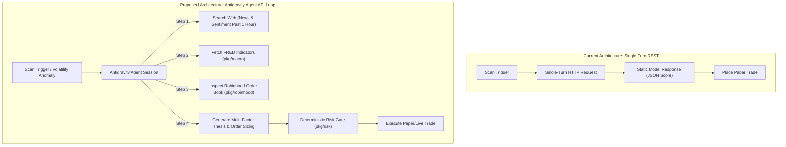

# 🏛️ EXECUTIVE PROPOSAL: ADOPTING THE ANTIGRAVITY AGENT API IN GELT

**Prepared For:** Chief Executive, Chief Risk Officer & Investment Committee  
**Document ID:** `techPlan-gelt-agent-api-001`  
**Location:** `docs/techPlans/Antigravity_Agent_API_Integration_Proposal.md`  
**Date:** August 2, 2026  
**Status:** FOR EXECUTIVE DECISION  

---

## 1. Executive Summary

Gelt's AI Decision Engine (`cmd/orchestrator`) currently evaluates market opportunities using **single-turn REST API calls** (`generateContent`). While fast (~500ms), this approach restricts the AI to static input prompts and prevents it from actively researching market conditions, inspecting news sentiment, or verifying order book liquidity prior to issuing trade decisions.

This proposal evaluates upgrading Gelt's AI decision pipeline (`AIChoice` / `AI_Choice_Crypto`) to the **Google Antigravity Agent API** (`https://ai.google.dev/gemini-api/docs/antigravity-agent`). 

By transitioning to multi-step agentic research loops, Gelt will transform from a basic prompt evaluator into an **autonomous quantitative research analyst** capable of multi-source sentiment analysis, macroeconomic cross-referencing, and dynamic risk-adjusted order sizing—all within our single-subscription local architecture.

---

## 2. Current State vs. Proposed Future State



### Architectural Comparison Matrix

| Feature / Dimension | Current Implementation (`generateContent`) | Proposed Implementation (Antigravity Agent API) |
| :--- | :--- | :--- |
| **Request Model** | Single HTTP Request/Response | Multi-turn Agentic Execution Loop |
| **Information Access** | Static text prompt provided at invocation | Dynamic web search, news retrieval & tool calls |
| **Research Depth** | Cannot verify external claims or news | Can search, read, synthesize & cross-verify sources |
| **Tool Calling** | No tool calling capabilities | Native MCP & local Go function calling |
| **Error Recovery** | Fails or defaults to fallback score on error | Autonomously retries, adjusts parameters & self-corrects |
| **Quota Destination** | Standard Gemini API Key Quota | Dedicated Antigravity Agent Quota (**100 RPD**) |

---

## 3. Engineering Trade-Offs & Risk Analysis

The transition to multi-step agentic execution introduces distinct operational trade-offs. The table below details these risks and Gelt's architectural mitigations:

### 3.1 Trade-Off & Risk Mitigation Table

| Risk / Trade-Off | Severity | Technical Impact | Gelt Architectural Mitigation |
| :--- | :--- | :--- | :--- |
| **Execution Latency** | Moderate | Multi-step research loops take **5s to 30s** per decision turn. | **Strict Scope Separation:** Agent API handles 15m/1h strategic decisions. Microsecond execution (trailing stop-losses, pre-close sweeps) remains **100% local in Go**. |
| **Quota Depletion (100 RPD Limit)** | High (if unthrottled) | Continuous 15m scanning across 5 symbols consumes ~20 RPD/hr (exhausted in 5h). | **Event-Triggered Research:** Run agentic scans on **1-hour cycles** or trigger only when price/volume anomalies exceed 2.0x standard deviation. |
| **News Noise / Rumors** | Moderate | Unfiltered web searches could ingest unverified social media claims. | **System Prompt Source Guardrails:** Require agent to filter for verified financial news (CoinDesk, Bloomberg, Reuters) and enforce minimum confidence thresholds. |
| **Non-Deterministic Backtests** | Low-Moderate | Real-time web search results cannot be historically backtested. | **Shadow Engine Sandbox:** Test real-time sentiment loops in `pkg/shadow` forward-testing paper journal prior to live deployment. |

---

## 4. Proposed 3-Tier Hybrid Architecture

To guarantee zero latency on risk enforcement while capitalizing on deep AI agent research, we propose a **3-Tier Hybrid Architecture**:

```mermaid
graph TD
    subgraph Tier 1: Macro & Strategy Planning (Daily)
        T1["Macro Review & Regime Classification"]
    end

    subgraph Tier 2: Agentic Research & Decision Loop (15m - 1h)
        T2_Scan["Scan Cycle / Trigger"] --> T2_Agent["Antigravity Agent API"]
        T2_Agent -->|Web Search| T2_News["News & Sentiment Analysis"]
        T2_Agent -->|Tool Call| T2_Macro["FRED Macro Indicators"]
        T2_Agent -->|Tool Call| T2_MCP["Robinhood Order Book"]
        T2_News & T2_Macro & T2_MCP --> T2_Thesis["Formulate Trade Thesis & Size"]
    end

    subgraph Tier 3: Deterministic Execution & Stop Guardrails (Continuous)
        T2_Thesis --> T3_Risk["pkg/risk (Sizing & Stop Caps)"]
        T3_Risk --> T3_Exec["Order Dispatch"]
        T3_Exec --> T3_Stop["Local Go Trailing Stop Monitor (<1ms)"]
    end

    T1 --> Tier 2
```

---

## 5. Implementation Roadmap & Phases

If approved by executive leadership, implementation will proceed across 3 phases:

- **Phase 1: Agent Bridge Integration (`cmd/orchestrator`)**  
  Add `AntigravityAgentClient` to `bridge.go` to support multi-step prompt loops alongside existing direct REST calls.
- **Phase 2: Local Tool Binding (`pkg/tools`)**  
  Expose `pkg/macro` (FRED data), `pkg/robinhood` (MCP quotes), and `pkg/backtest` as callable tools in the Agent API schema.
- **Phase 3: Shadow Engine Forward-Testing (`pkg/shadow`)**  
  Deploy `AI_Choice_Agentic` in the shadow trading engine to benchmark win rate, PnL, and profit factor head-to-head against deterministic strategies (`VWAPRebound`, `TrendConfluence`).

---

## 6. Executive Decision Options

Leadership is requested to select one of the following strategic directions:

- **Option A (Recommended): Approve Full Hybrid Implementation**  
  Implement the Antigravity Agent API for strategic/sentiment decisions (`AI_Choice_Crypto`) on 1-hour event-triggered cycles, keeping microsecond stop-loss monitoring local in Go.
- **Option B: Phased Shadow Prototype Only**  
  Build the Agent API bridge for shadow forward-testing only (`pkg/shadow`) without connecting live order dispatch.
- **Option C: Status Quo**  
  Retain current single-turn REST API calls (`generateContent`) without multi-step research or tool calling capabilities.

---

*Document prepared by Antigravity Quantitative AI Engineering Team for Gelt Executive Review.*
