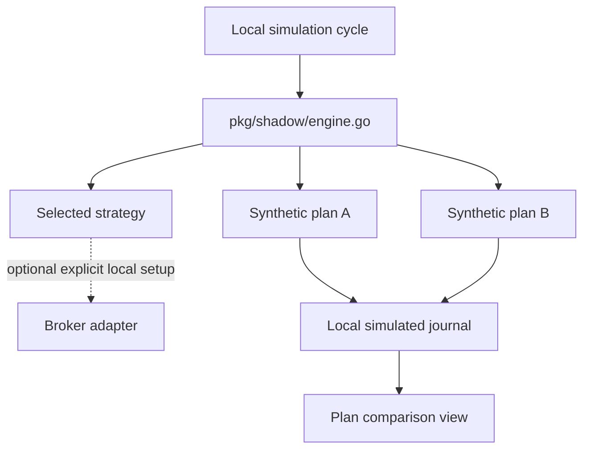

# Gelt Shadow Trading and Forward-Test Engine

> **Synthetic-only examples:** Names, aliases, symbols, quantities, prices, and results in this plan are invented fixtures. They do not describe an account, order, position, or measured strategy performance.

## Overview

The shadow engine evaluates non-selected plans using simulated entries and exits. Its journal supports local comparisons between plan logic. Shadow results are simulated records and must not be presented as broker executions or live performance.

An example configuration may use the fictional alias `acct-demo-001` and symbol `DEMO`; neither is a real account or security identifier. Broker account identifiers come only from the existing local configuration contract. If no account identifier is configured, the health diagnostic reports that state instead of supplying a default.

## Architecture



## Data models

`ShadowTrade` and `PlanPerformance` describe the shape of simulated records. The following values are fabricated examples, not observations:

```json
{
  "id": "demo-trade-001",
  "plan_name": "SyntheticRangePlan",
  "symbol": "DEMO",
  "side": "buy",
  "entry_price": 10.00,
  "exit_price": 11.00,
  "quantity": 2,
  "amount_usd": 20.00,
  "pnl_usd": 2.00,
  "pnl_pct": 10.00,
  "status": "CLOSED"
}
```

The comparison view should label this class of data as simulated. Do not reuse private account, order, position, or performance records in examples or screenshots.

## CLI

- `gelt shadow` displays the local plan-comparison view.
- `gelt shadow trades` displays simulated journal entries.
