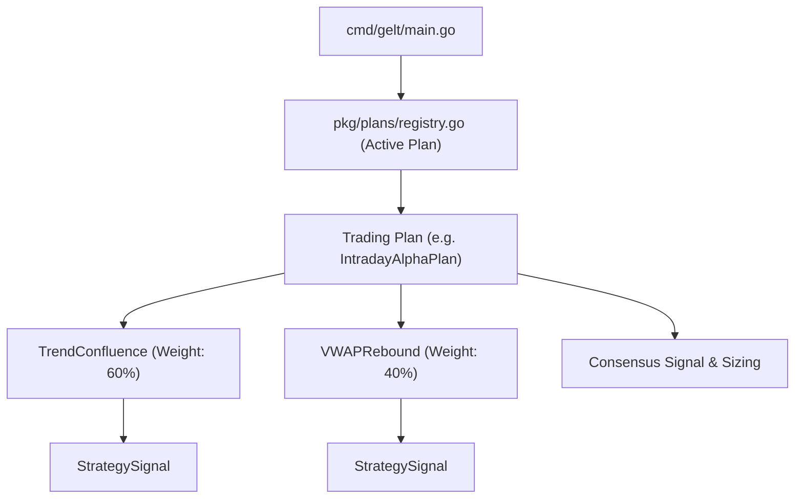

# Gelt Trading Plan Engine Technical Plan 📐

## Overview
The **Trading Plan Engine** (`pkg/plans`) introduces a high-level abstraction tier above the Strategy Catalog. While **Strategies** (`pkg/strategies`) act as atomic signal generators, a **Trading Plan** orchestrates multiple strategies together with specific weights, risk rules, and execution conditions. Gelt operates under **one active Trading Plan** at any given time.

---

## 🏗️ Architecture & Abstraction Layers



---

## 📐 Data Models (`pkg/plans/plan.go`)

### 1. `WeightedStrategy`
```go
type WeightedStrategy struct {
	Strategy strategies.Strategy
	Weight   float64 // Weight between 0.0 and 1.0 (sums to 1.0)
}
```

### 2. `TradingPlan` Interface
```go
type TradingPlan interface {
	Name() string
	Description() string
	Strategies() []WeightedStrategy
	EvaluateEnsemble(symbol string, closes []float64, volumes []float64) (PlanEvaluation, error)
}
```

### 3. `PlanEvaluation`
```go
type PlanEvaluation struct {
	PlanName        string                     `json:"plan_name"`
	Symbol          string                     `json:"symbol"`
	ConsensusSignal strategies.SignalType      `json:"consensus_signal"` // BUY, SELL, HOLD
	WeightedScore   float64                    `json:"weighted_score"`   // Composite 0-100 score
	StopLossPct     float64                    `json:"stop_loss_pct"`
	TargetPct       float64                    `json:"target_pct"`
	StrategySignals []strategies.StrategySignal `json:"strategy_signals"`
	Rationale       string                     `json:"rationale"`
	Timestamp       time.Time                  `json:"timestamp"`
}
```

---

## 🏛️ Built-In Trading Plans

1. 🚀 **`IntradayAlphaPlan`** (Default):
   - Combines `TrendConfluence` (60%) + `VWAPRebound` (40%).
   - Designed for high-momentum liquid US equities and ETFs.

2. 🛡️ **`RangeBoundDefensivePlan`**:
   - Combines `MeanReversion` (70%) + `VWAPRebound` (30%).
   - Tailored for low-volatility, sideways market environments.

3. ⚡ **`BreakoutExpansionPlan`**:
   - Combines `BreakoutVol` (70%) + `TrendConfluence` (30%).
   - Focused on catalyst-driven volatility expansion events.

---

## 💻 CLI Integration

- `gelt plan active` — Displays the currently active Trading Plan and its underlying strategies.
- `gelt plan list` — Displays all available Trading Plans in the catalog.
- `gelt plan set <PLAN_NAME>` — Switches Gelt's active Trading Plan.
