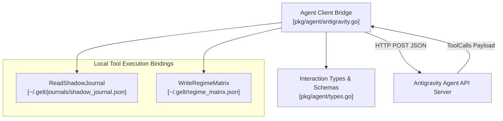

# Gelt Antigravity Agent Bridge (`pkg/agent`)

The `pkg/agent` package provides the multi-turn agentic client bridge and session manager connecting Gelt to the Antigravity Agent API.

## Architecture & Component Topology

## Features

- **Multi-Turn Execution Loop**: Automatically handles agent tool calls (`ReadShadowJournal`, `WriteRegimeMatrix`) up to a 10-turn safety ceiling.
- **Path Traversal Protection**: Restricts shadow journal reads strictly to `~/.gelt/journals/shadow_journal.json`.
- **Thread-Safe Regime Persistence**: Obtains `macro.MatrixMutex` write-locks when updating macro regime matrices.
- **Cross-Platform Compatibility**: Fully tested across Windows (`USERPROFILE`) and Unix (`HOME`) environments.
