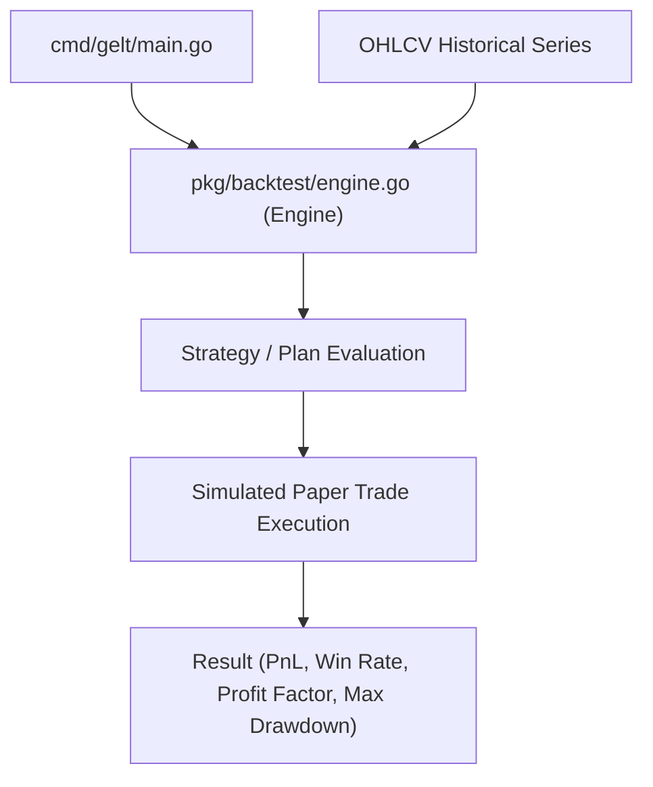

# Gelt Historical Backtester (`pkg/backtest`)

The `pkg/backtest` package provides deterministic historical simulation engines for quantitative strategies and multi-strategy trading plan ensembles in Gelt.

## Architecture



## Features

- **Deterministic Execution**: Simulates paper trade execution over historical OHLCV price bars.
- **Performance Metrics**: Calculates Win Rate, Net PnL, Profit Factor, and Maximum Drawdown Percentage across historical windows.
- **Strategy & Plan Support**: Backtests both individual strategies and combined Trading Plan ensembles.
- **Fail-Closed Historical Input**: Before any evaluation, rejects empty series, nonpositive or non-increasing Unix-second timestamps, non-finite values, nonpositive OHLC prices, negative volume, and inconsistent OHLC bounds. A valid single-bar series is accepted. Evaluation times come from the supplied bars; there is no wall-clock timestamp fallback.

## Opt-in causal replay (TASK_010-A)

`Engine.Run` and the existing `gelt backtest` command retain the legacy model
and result meaning. `Engine.RunCausal` is a separate, bounded diagnostic model:
`gelt.legacy-go.close-next-open.v1`, `frictionless_diagnostic`,
`unqualified_offline`. It is not actual paper/live trading or qualification.

```text
gelt backtest-causal BreakoutVol TEST synthetic.csv
```

This new command requires an existing offline CSV. It never generates missing
input or fetches data. Only exact `BreakoutVol` is supported in the CLI; all other
strategy/plan names reject explicitly. The Go API supports trusted standalone
strategies and plans with complete, stable declared membership; CLI plan loading
and arbitrary catalog initialization are not enabled. See the
[TASK_010 implementation specification](../../docs/specs/TASK_010_Historical_Backtester.md)
for numeric bounds, event ordering, compatibility and verification limitations.

CSV has exact `Timestamp,Open,High,Low,Close,Volume` header and six unquoted ASCII
fields, at most 1 MiB/10,000 rows/32 bytes per token. LF/CRLF and one final newline
are allowed; malformed rows, blank rows, whitespace, signs, exponents, quotes,
BOM and extra columns reject. Values become float64, not exact-decimal money.

The summary reports gross realized diagnostics, nullable profit factor and an
explicit final open model position. Final directional-signal pending can be a
no-op; it does not represent an actual unfilled order. No fees, slippage, cash,
equity or drawdown model is added. Legacy metric names retain their historical
limitations; they must not be read as corrected causal accounting.
