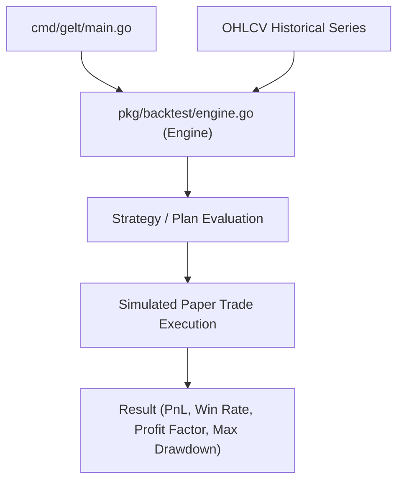

# Gelt Historical Backtester (`pkg/backtest`)

The `pkg/backtest` package provides deterministic historical simulation engines for quantitative strategies and multi-strategy trading plan ensembles in Gelt.

## Architecture

## Features

- **Deterministic Execution**: Simulates paper trade execution over historical OHLCV price bars.
- **Performance Metrics**: Calculates Win Rate, Net PnL, Profit Factor, and Maximum Drawdown Percentage across historical windows.
- **Strategy & Plan Support**: Backtests both individual strategies and combined Trading Plan ensembles.
- **Fail-Closed Historical Input**: Before any evaluation, rejects empty series, nonpositive or non-increasing Unix-second timestamps, non-finite values, nonpositive OHLC prices, negative volume, and inconsistent OHLC bounds. A valid single-bar series is accepted. Evaluation times come from the supplied bars; there is no wall-clock timestamp fallback.
