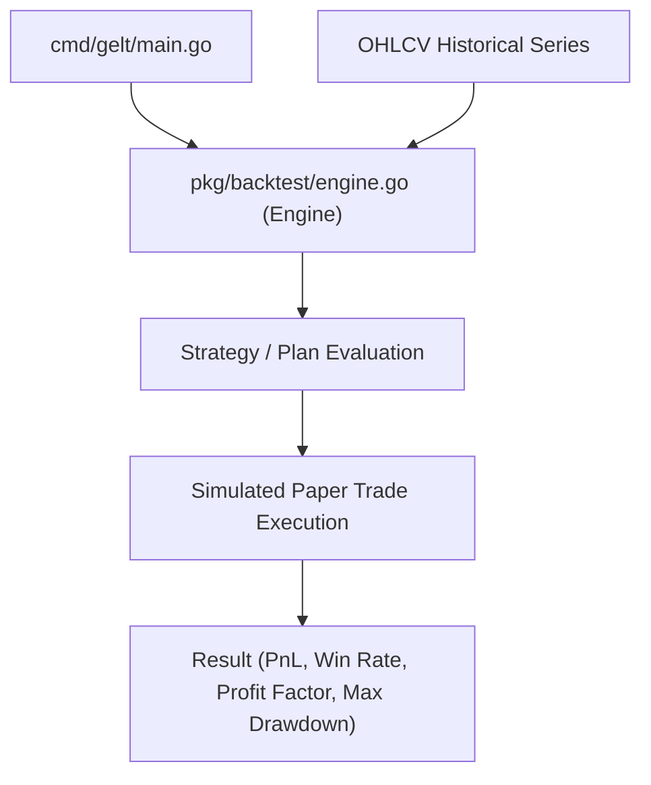

# Gelt Historical Backtester (`pkg/backtest`)

The `pkg/backtest` package provides deterministic historical simulation engines for quantitative strategies and multi-strategy trading plan ensembles in Gelt.

## Architecture



## Features

- **Deterministic Execution**: Simulates paper trade execution over historical OHLCV price bars.
- **Performance Metrics**: Calculates Win Rate, Net PnL, Profit Factor, and Maximum Drawdown Percentage across historical windows.
- **Strategy & Plan Support**: Backtests both individual strategies and combined Trading Plan ensembles.
- **Fail-Closed Historical Input**: Before any evaluation, rejects empty series, nonpositive or non-increasing Unix-second timestamps, non-finite values, nonpositive OHLC prices, negative volume, and inconsistent OHLC bounds. A valid single-bar series is accepted. Evaluation times come from the supplied bars; there is no wall-clock timestamp fallback.

## Opt-in causal replay (TASK_010-A)

`Engine.Run` and the existing `gelt backtest` command retain the legacy model
and result meaning. `Engine.RunCausal` is a separate, bounded diagnostic model:
`gelt.legacy-go.close-next-open.v1`, `frictionless_diagnostic`,
`unqualified_offline`. It is not actual paper/live trading or qualification.

```text
gelt backtest-causal BreakoutVol TEST synthetic.csv
```

This new command requires an existing offline CSV. It never generates missing
input or fetches data. Only exact `BreakoutVol` is supported in the CLI; all other
strategy/plan names reject explicitly. The Go API supports trusted standalone
strategies and plans with complete, stable declared membership; CLI plan loading
and arbitrary catalog initialization are not enabled. See the
[TASK_010 implementation specification](../../docs/specs/TASK_010_Historical_Backtester.md)
for numeric bounds, event ordering, compatibility and verification limitations.

CSV has exact `Timestamp,Open,High,Low,Close,Volume` header and six unquoted ASCII
fields, at most 1 MiB/10,000 rows/32 bytes per token. LF/CRLF and one final newline
are allowed; malformed rows, blank rows, whitespace, signs, exponents, quotes,
BOM and extra columns reject. Values become float64, not exact-decimal money.

The A summary reports gross realized diagnostics, nullable profit factor and an
explicit final open model position. Final directional-signal pending can be a
no-op; it does not represent an actual unfilled order. No fees, slippage, cash,
equity or drawdown model is added. Legacy metric names retain their historical
limitations; they must not be read as corrected causal accounting.

## Opt-in funded close-mark replay (TASK_010-B1)

The separate `Engine.RunFundedCausal(ctx, symbol, bars, initialModelCash)` API
uses model `gelt.legacy-go.funded-close-next-open.v1`, cost identity
`frictionless_funded_fixed8_diagnostic` and `unqualified_offline` labels.
Legacy Run/Result/backtest and A RunCausal/backtest-causal retain their behavior.

```text
gelt backtest-causal-funded BreakoutVol TEST synthetic.csv 100.00000000
```

Exactly four arguments are required, with the same bounded strict CSV parser and
exact BreakoutVol-only resolver. Declared starting model cash is mandatory:
unsigned ordinary ASCII decimal, no signs/exponents/whitespace/leading-zero
integer, at most eight fractional digits, range0..1,000,000 modelUSD. This fixed8
engineering resolution is not broker currency policy or an actual cash balance.

An eligible entry still sizes nominal modelUSD10. Insufficient cash records a
nonfill before position/protection creation and replay continues; active BUY and
flat SELL remain no-ops. Cash debit, exit credit and position value use exact
binary-rational price × quantity, rounded once to fixed8 with nearest ties-even.
Fill prices, quantities and touch predicates are not rounded by this layer.

Every supplied bar, including warmup, receives a close mark. Equity equals cash
plus position value and initial equity plus realized/unrealized accounting PnL.
Maximum drawdown uses initial equity and subsequent close peaks, retaining exact
loss/peak units and the earliest maximum on ties. Zero initial equity produces
null with `zero_initial_model_equity`, not a favorable zero. Terminal positions
are marked, never forcibly liquidated. Float gross diagnostics remain separate.

The human summary is at most8192 UTF8 bytes and displays monetary values with
exactly eight fractional digits. One output write is attempted; failure returns
nonzero and may retain a prefix. No JSON export, persistence, fees/slippage,
actual capital, acquisition, trading or qualification is added. See the
[B1 specification](../../docs/specs/TASK_010_Historical_Backtester.md#task_010-b1-funded-accounting-source-candidate-2026-11-02)
for bounds, verification and delivery status.


## Opt-in declared-fee replay (TASK_010-B2a)

```text
gelt backtest-causal-fees BreakoutVol TEST synthetic.csv 100.00000000 1.00000000 0
```

Exactly6 arguments; mandatory initial model cash, fixed fee per filled side and
integer basis-point rate. `RunFeeScenarioCausal` is a separate versioned mode,
not a change to legacy/A/B1. Model
`gelt.legacy-go.fee-scenario-close-next-open.v1`, cost
`declared_fixed8_per_side_fee_scenario`, `uncalibrated_declared` fee basis and
`unqualified_offline` data/authority are explicit in the bounded human summary.
Fixed fee is0<=fee<10 modelUSD with up to8 fractional digits; canonical bps is
0..10000. These are engineering bounds, not actual broker pricing.

The simulated10 modelUSD entry cap includes the entry fee. Principal is sized
using exact integer/rational arithmetic; no partial funding, loan or fee waiver.
Fees apply only to actual modeled filled sides. Close equity includes retained
entry fees and marks open positions; there is no forced liquidation or assumed
exit fee. Gross diagnostics and net accounting are separately labeled. A negative
exit cash delta must be funded or the new mode returns a sanitized fatal error
with zero result. Explicit zero fees preserve B1 trace/accounting except new
identities/fee fields. No slippage, acquisition, trading, actual spending,
calibration, persistence or operating qualification. See the
[B2a specification and retained verification limits](../../docs/specs/TASK_010_Historical_Backtester.md#task_010-b2a-declared-fee-source-candidate-2026-11-02).


## Legacy command reporting

The existing `gelt backtest` command remains the simplified legacy engine.
Its human report now labels gross price PnL (the unchanged `Result.NetPnL` field),
realized-exit drawdown on the legacy model10000 baseline, forced terminal close
and excluded costs. It does not gain causal fills, close-mark equity or fees.
Generated fallback input is explicitly `wallclock_seeded_synthetic`; supplied CSV
is `user_supplied_csv_unqualified`. Neither establishes historical-data quality.
Nonfinite or no-trade profit factors display undefined; finite legacy values do
not establish a valid denominator or adequacy. Calculations and Result fields
are unchanged; legacy text consumers need to migrate the intentionally changed
labels. A/B1/B2a commands keep their existing output. See the
[report boundary and verification limits](../../docs/specs/TASK_010_Historical_Backtester.md#legacy-cli-report-boundary-2026-11-03).


## Opt-in declared adverse execution prices (TASK_010 follow-on)

```text
gelt backtest-causal-execution BreakoutVol TEST synthetic.csv 100 0 0 100 100
```

Separate offline model: initial simulated cash, fixed per-side fee, fee bps,
BUY adverse bps and SELL adverse bps are explicit. Rates are uncalibrated stress
assumptions, not observed or realistic execution. Existing commands are unchanged.
Reference trigger/protection geometry remains separate from modeled execution
prices; targets are not guaranteed limit fills and quotes are not clamped to OHLC.
Entry sizing keeps the simulated $10 cap fee-inclusive. Cash/equity include the
execution-price effect once, with fees on actual modeled notional. Close marks
and terminal open positions do not assume liquidation or hypothetical exit costs.
See the [execution-price contract](../../docs/specs/TASK_010_Historical_Backtester.md#declared-adverse-execution-price-scenario-2026-11-08)
for rounding, bounds, output limitations and required review/delivery gates.
No live data, broker calls, money, calibration, trading or qualification.


## Opt-in cash/passive comparison

```text
gelt backtest-causal-compare BreakoutVol TEST supplied.csv 100 1 10 100 100
```

This separate command and `Engine.RunComparisonCausal` compare one unchanged
execution-price strategy replay with flat cash and one passive lot. The complete
strict supplied CSV and cost declarations are shared. Passive eligibility is
index20 open after20 supplied closes, independent of strategy signals. It buys
once only if the fee-inclusive debit (at most10 modelUSD) is fully funded, then
holds to the final supplied close. An unaffordable lot is recorded as one nonfill;
there is no resizing, borrowing, later retry, protection, rebalancing or terminal
sale. No SELL fee or adverse SELL price is charged without a SELL.

All supplied closes, including warmup, carry cash/value/equity/accounting PnL,
fees and close-mark drawdown. The bounded human table shows three models and two
signed ending-equity gaps. The CLI independently reconstructs controls against
the actual bars before displaying them. Cash, exposure duration, protection and
turnover differ: this is declared, uncalibrated scenario accounting, not ranking,
statistical edge, profitability or qualification. Supplied-data provenance and
supplier finality remain unknown. Existing commands and modes are unchanged.
See [the comparison contract and source evidence](../../docs/specs/TASK_010_Causal_Comparison.md).

### Declared-window comparison

The separate `backtest-causal-window-compare` command selects an exact inclusive
start and exclusive end (or final-timestamp-plus-one sentinel), validates the full
supplied CSV, and replays only twenty prior warmup bars plus the selected window.
It reports source/relative/scored mapping and strategy/cash/passive scored equity,
costs and close-mark drawdown. Existing whole-input commands remain unchanged.
Input selection is isolated; independent display checks cover original-close
marks, controls and trace/accounting consistency, not original-OHLC strategy-fill
causality or untouched-data evidence. See the [declared-window specification](../../docs/specs/TASK_010_Declared_Window_Comparison.md).

### TrendConfluence fixed-50 comparison

`backtest.RunTrend50ComparisonCausal` runs the existing default TrendConfluence
strategy against the entire validated input and compares it with flat cash and
one passive lot. Its first evaluation is at index 49, and the first possible
strategy fill and passive entry are at index 50. The CLI is
`gelt backtest-causal-trend50-compare TrendConfluence SYMBOL CSV CASH FIXED_FEE FEE_BPS BUY_BPS SELL_BPS`.
It reconstructs reference events and accounting from the supplied OHLC and
normalized signals before displaying a bounded table. It does not independently
verify the strategy's indicator calculations. This is an unqualified offline,
uncalibrated scenario; cadence, session, selection history and intraday operating
eligibility are unestablished. It does not establish edge or trading readiness.
See [the comparison specification](../../docs/specs/TrendConfluence50-Comparison.md).
