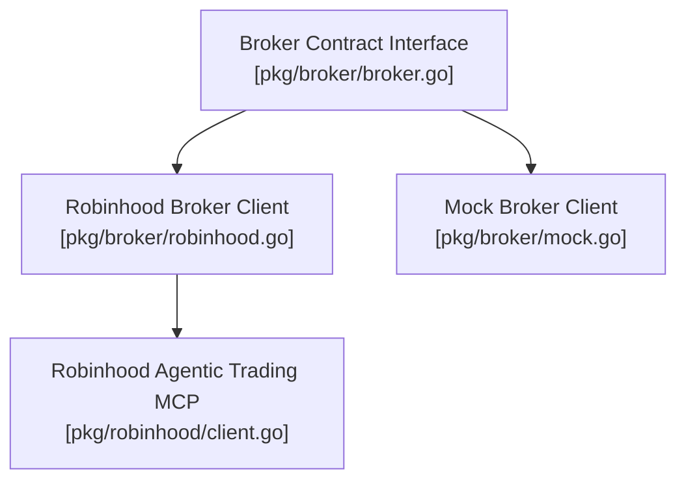

# Gelt Broker Abstraction (`pkg/broker`)

The `pkg/broker` package provides Gelt's abstract broker contract and Robinhood API client implementation for account state synchronization, buying power querying, and order execution.

## Architecture & Component Topology

## Core Capabilities

1. **Portfolio Synchronization**: Fetch equity positions, buying power, and unallocated cash balances.
2. **Order Execution**: Place limit and market buy/sell orders with position-size pre-checks.
3. **Mock Isolation**: 100% offline mock implementation for testing and backtests without network dependencies.
