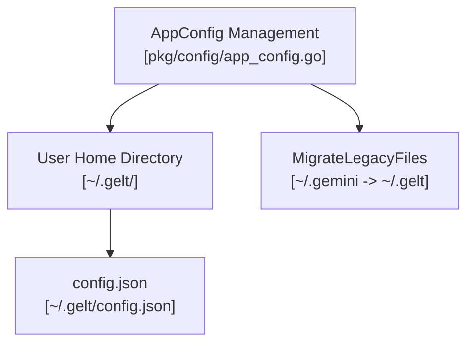

# Gelt Configuration Engine (`pkg/config`)

The `pkg/config` package manages user application configuration, path resolution, legacy file migration, and default configuration initialization in `~/.gelt/config.json`.

## Architecture & Component Topology

## Features

- **Cross-Platform Directory Resolution**: Evaluates `%USERPROFILE%` / `$HOME` to locate `~/.gelt/`.
- **Legacy Migration Support**: Seamlessly migrates legacy `~/.gemini/` configuration files to `~/.gelt/`.
- **Default Scaffolding**: Automatically creates missing directory trees (`~/.gelt/journals/`, `~/.gelt/logs/`).
