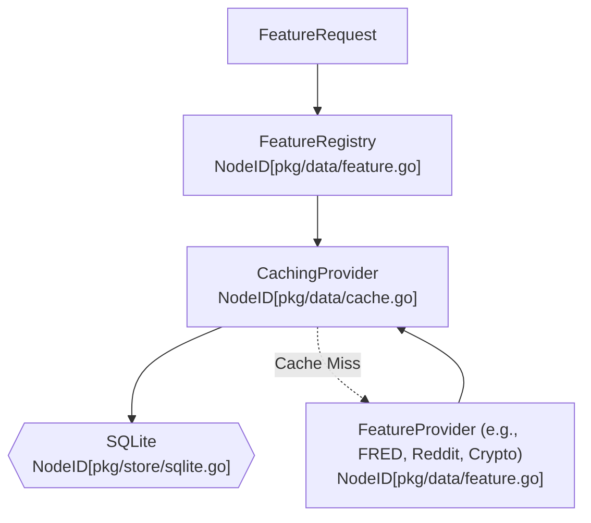

# `pkg/data`

The `pkg/data` module provides asynchronous, thread-safe ingestion engines, normalization, and local SQLite caching for Gelt. It uses a core `FeatureProvider` interface and a thread-safe `FeatureRegistry` to unify time-series data fetching across vendors (FRED, Reddit, Crypto).

## Architecture

## Features

- **CachingProvider**: Wraps external feature providers to prevent rate limits and reduce latency. It evaluates TTL staleness per `feature_key` and natively supports cache hits for sub-range queries.
- **FeatureRegistry**: A thread-safe registry that routes feature requests based on prefix matching.
- **Data Ingestion Clients**: Manages data fetching models (such as `RedditClient` for Reddit OAuth API calls and spot price connectors).
