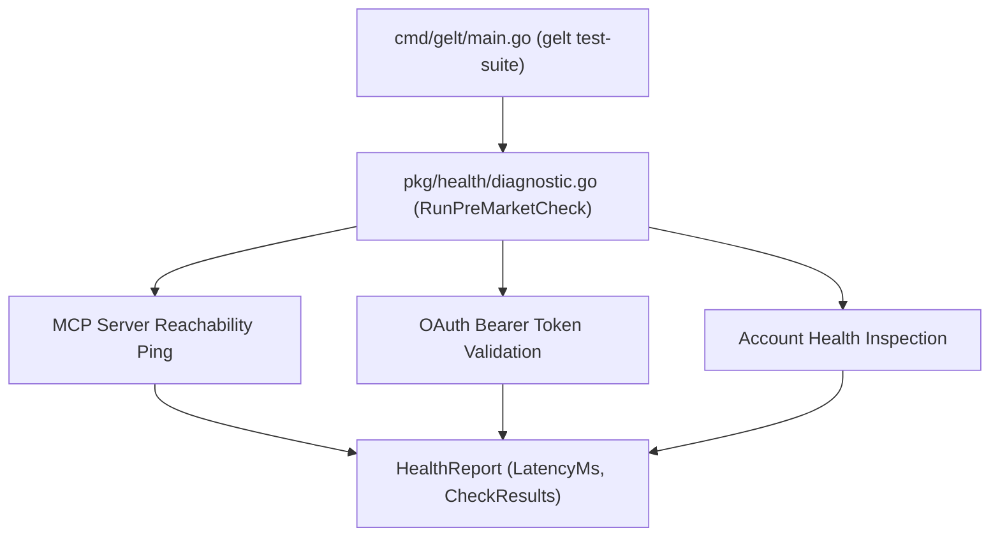

# Gelt Pre-Market Health Diagnostics (`pkg/health`)

The `pkg/health` package provides pre-market health and latency diagnostic checks for Gelt, inspecting Robinhood MCP server reachability, OAuth token validity, and account status prior to market open.

## Architecture

## Features

- **Pre-Market Diagnostics**: Runs automated health checks on MCP connection, authentication, and API latency.
- **Latency Monitoring**: Tracks millisecond round-trip response times to Robinhood trading servers.
- **Health Report Payload**: Returns structured `HealthReport` details for telemetry and CLI health dashboards.
