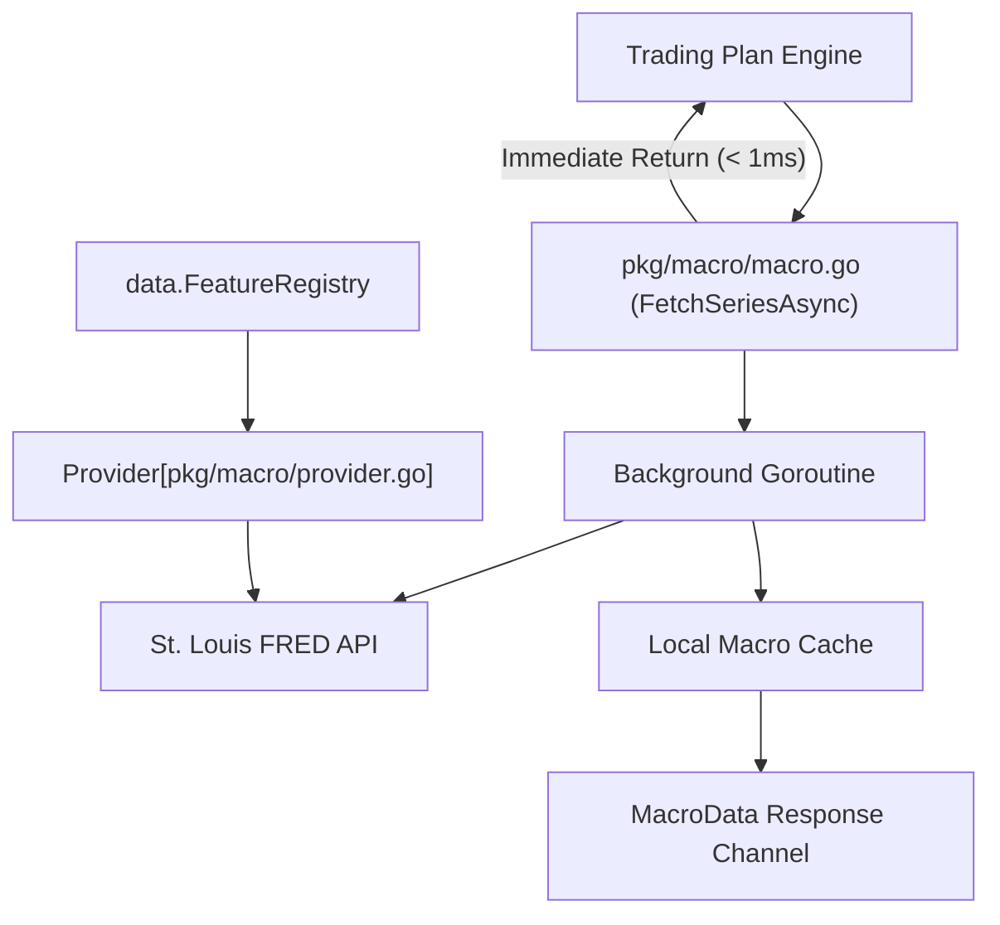

# Gelt Macro Data Ingestion Engine (`pkg/macro`)

The `pkg/macro` package provides non-blocking, asynchronous ingestion of macroeconomic indicators (e.g. Effective Federal Funds Rate / EFFR) from the Federal Reserve Economic Data (FRED) API.

## Architecture

## Features

- **Asynchronous Non-Blocking Execution**: `FetchSeriesAsync` launches a background goroutine and returns a channel immediately, isolating the main trading thread from network latency.
- **Resilient Fallbacks**: Gracefully serves cached macro series or baseline rate metrics if network or API key is unavailable.
- **Thread-Safe Caching**: Protects macro series state across concurrent strategy evaluations.
- **FeatureProvider Integration**: Includes `FredProvider` (and `RegisterProvider`) which implements the standard `data.FeatureProvider` interface for systematically retrieving continuous macro time series with missing gap forward-filling.
