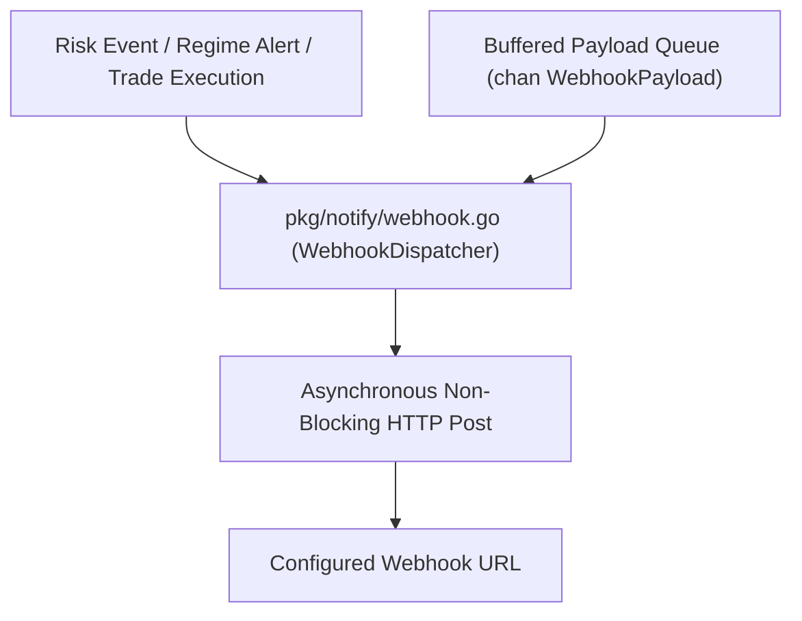

# Gelt Notification Engine (`pkg/notify`)

The `pkg/notify` package provides asynchronous, thread-safe HTTP webhook dispatching for risk governance events, regime alerts, and trade execution notifications in Gelt.

## Architecture

## Features

- **Non-Blocking Ingestion**: Queues alerts asynchronously via buffered channels, guaranteeing 0ms latency impact on main trading threads.
- **Alert Severities**: Categorizes alerts by severity levels (`INFO`, `WARNING`, `CRITICAL`).
- **Thread-Safe Dispatcher**: Provides global and custom webhook dispatchers with context cancellation support.
