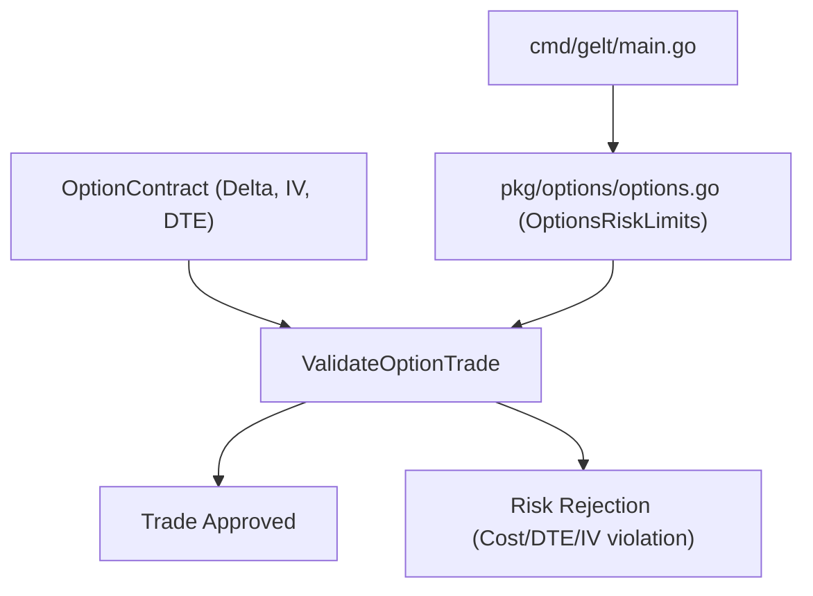

# Gelt Options Risk Engine (`pkg/options`)

The `pkg/options` package provides options contract evaluation, DTE constraints, implied volatility bounds, and position sizing guardrails for Gelt.

## Architecture

## Features

- **Options Contract Validation**: Enforces minimum DTE thresholds (e.g. 14 DTE minimum to avoid 0DTE theta decay).
- **IV Crush Guardrails**: Caps maximum allowable Implied Volatility (IV <= 80%) to prevent buying inflated contract premiums.
- **Account Sizing Scaling**: Provides calibrated limits for full-sized accounts ($200 contract cap) and test accounts ($10 contract cap).
