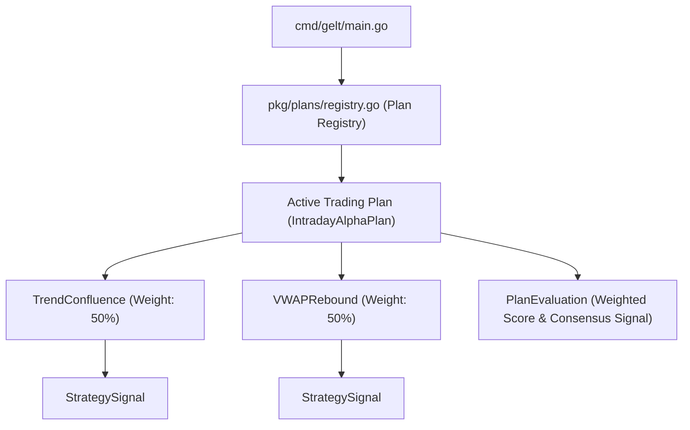

# Gelt Trading Plan Engine (`pkg/plans`)

The `pkg/plans` package implements Gelt's Trading Plan Engine. A **Trading Plan** is an ensemble orchestrator that combines one or more strategies from the **Strategy Catalog** (`pkg/strategies`) with specific weights, risk rules, and consensus signal logic. Gelt operates under **one active Trading Plan** at any given time.

## Architecture

## Built-In Trading Plans

1. 🚀 **`IntradayAlphaPlan`** (Default): Combines `TrendConfluence` (50%) + `VWAPRebound` (50%).
2. 🛡️ **`RangeBoundDefensivePlan`**: Combines `MeanReversion` (70%) + `VWAPRebound` (30%).
3. ⚡ **`BreakoutExpansionPlan`**: Combines `BreakoutVol` (70%) + `TrendConfluence` (30%).
