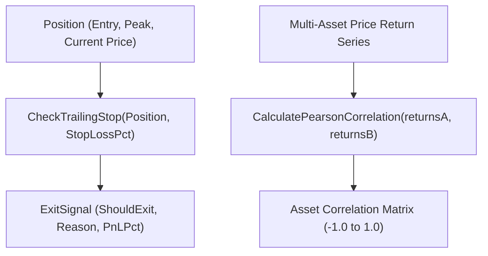

# Package portfolio 📈

`pkg/portfolio` provides trailing stop evaluation, asset correlation analysis, and dynamic risk management for Gelt.

## Features

- **Dynamic Trailing Stop**: Calculates high-water mark peak price and triggers exit signals on percentage drops.
- **Pearson Asset Correlation**: Measures return correlation between holdings to enforce diversification boundaries.
- **Zero-Cost Local Computation**: Ultra-fast Go mathematical evaluation.
