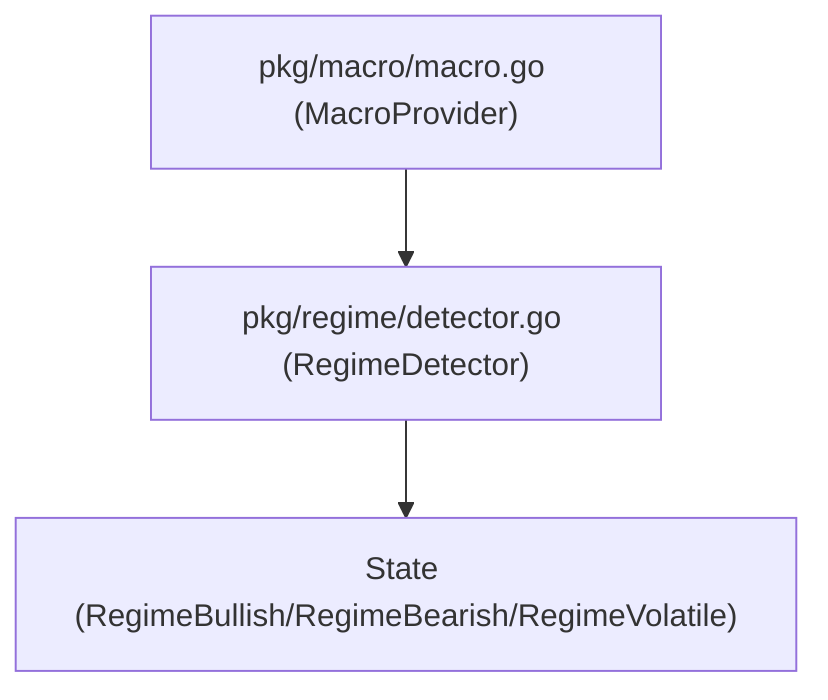

# Regime Package

The `pkg/regime` package is responsible for evaluating current market conditions by consuming data from the macro provider (e.g., FRED indicators, VIX, SPY) and translating them into discrete states (Bullish, Bearish, Volatile).

## Architecture

