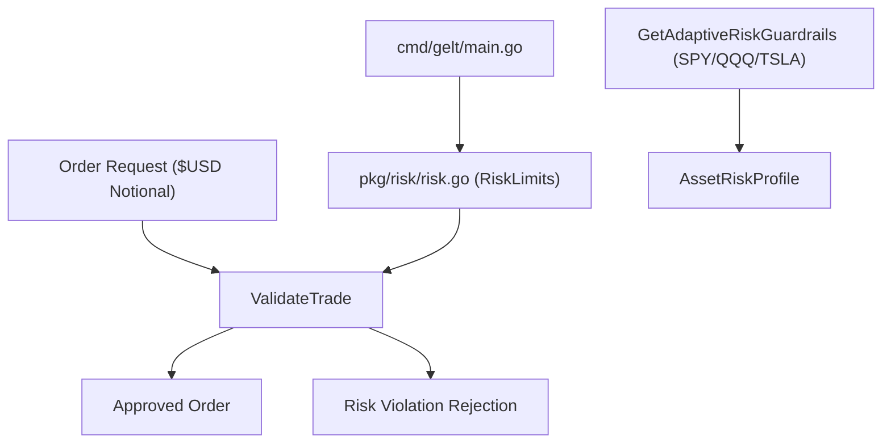

# Gelt Equity Risk Governance Engine (`pkg/risk`)

The `pkg/risk` package provides position sizing validation, adaptive asset guardrails, daily loss caps, and pre-close window detection for Gelt.

## Architecture

## Features

- **Adaptive Guardrails**: Tailors intraday stop-loss and profit target percentages based on asset class volatility (e.g. SPY: 0.35% / 0.70%, TSLA/NVDA: 1.50% / 3.00%).
- **Account Scaling**: Calibrates trade size and daily loss limits between production accounts and $50 paper test accounts.
- **Pre-Close Execution Window**: Detects 3:50 PM - 3:59 PM ET intraday exit windows.
