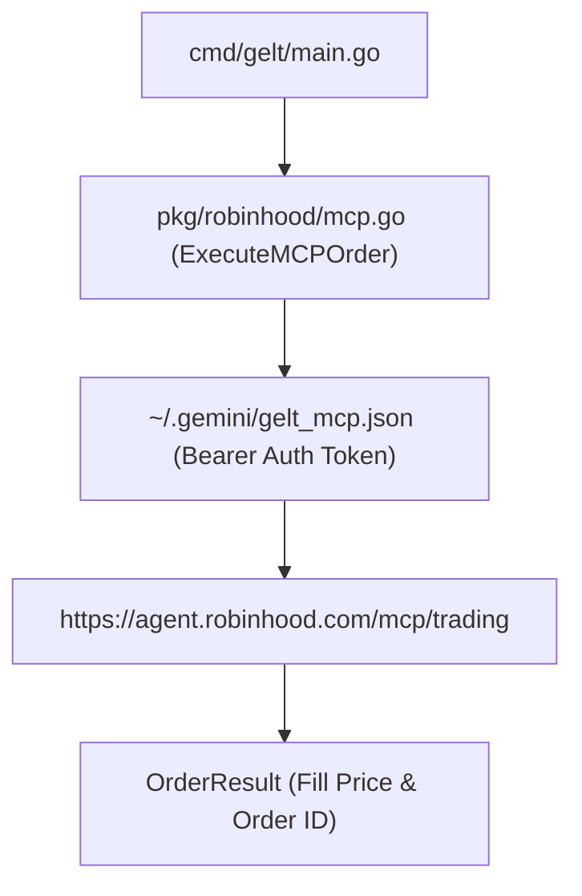

# Gelt Robinhood MCP Integration (`pkg/robinhood`)

The `pkg/robinhood` package provides OAuth 2.0 PKCE authentication, Model Context Protocol (MCP) tool invocation, and order routing to the Robinhood Agentic Trading Server.

## Architecture

## Features

- **OAuth 2.0 PKCE Interactive Login**: Automatically launches browser login flow with local HTTP callback handler to acquire bearer authentication tokens.
- **MCP Tool Invocation**: Dispatches JSON-RPC 2.0 tool requests (`place_equity_order`) to the Robinhood Agentic Server.
- **Config Persistence**: Saves endpoint URLs and bearer tokens securely in `~/.gemini/gelt_mcp.json`.
