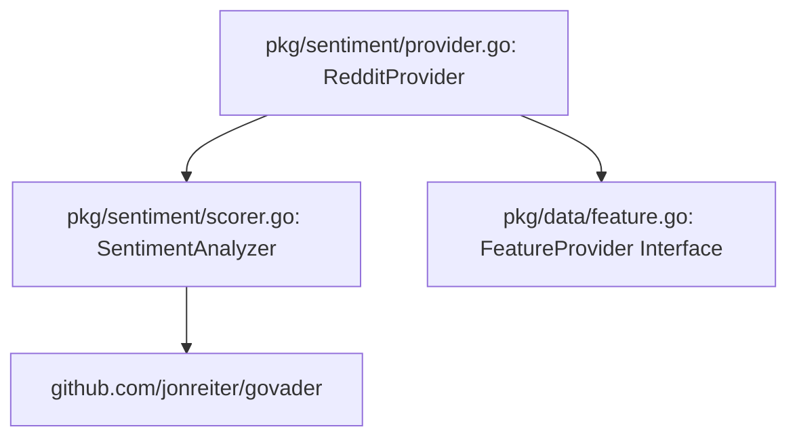

# pkg/sentiment

The `pkg/sentiment` module provides local VADER sentiment analysis using `github.com/jonreiter/govader`, enhanced with a custom financial lexicon to evaluate text and compute retail momentum scores.

