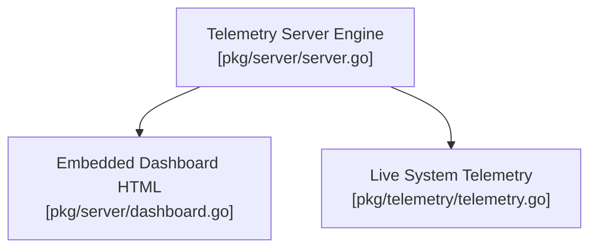

# Gelt Web Telemetry & Dashboard Server (`pkg/server`)

The `pkg/server` package provides the embedded HTTP server and web dashboard API endpoints serving live engine telemetry, broker connection status, buying power, and active strategy states.

## Architecture & Component Topology

## Features

- **Embedded Assets**: Serves dashboard assets via Go's native `go:embed`.
- **Zero-Fake Telemetry**: Exposes real SQLite and broker metrics via `/api/telemetry` and `/api/status`.
- **Non-Blocking Execution**: Runs on dedicated background goroutines without interfering with trading loops.
