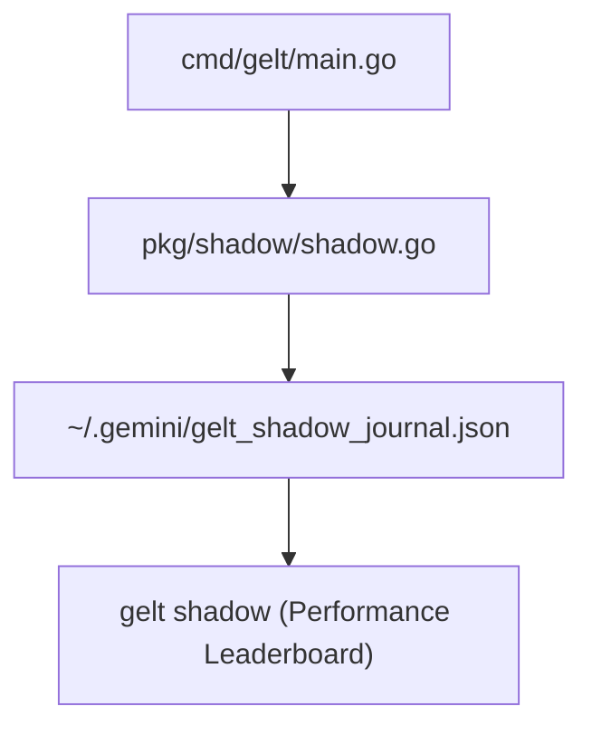

# Gelt Shadow Trading Engine (`pkg/shadow`)

The `pkg/shadow` package provides parallel paper forward-testing ("Shadow Trading") for inactive Gelt Trading Plans.

## Architecture

## Features

- **Parallel Evaluation**: Non-active Trading Plans evaluate market data side-by-side with live trading on every 15-minute cycle.
- **Paper Fills**: Virtual positions are opened and closed with dynamic ATR trailing stops.
- **Real-Time Performance Leaderboard**: Displays Win Rate, Total PnL ($), Profit Factor, Average Win / Average Loss ($), and Max Drawdown ($) comparing live trading against candidate shadow plans.
