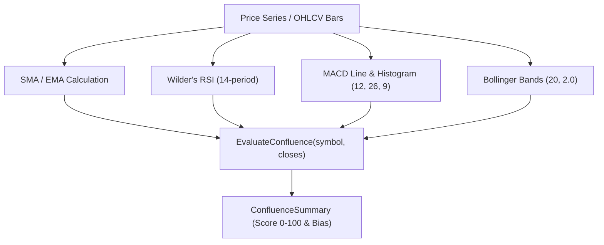

# Package signals 📊

`pkg/signals` provides high-performance technical indicator calculations and multi-indicator confluence evaluation for Gelt.

## Features

- **Calculations**: `SMA`, `EMA`, `RSI`, `MACD`, `BollingerBands`.
- **Confluence Scoring**: Evaluates 5 technical parameters to assign a 0.0–100.0 score and market bias (`BULLISH`, `NEUTRAL`, `BEARISH`).
- **Zero-Cost & Local Execution**: Sub-millisecond Go math without external paid API dependencies.
