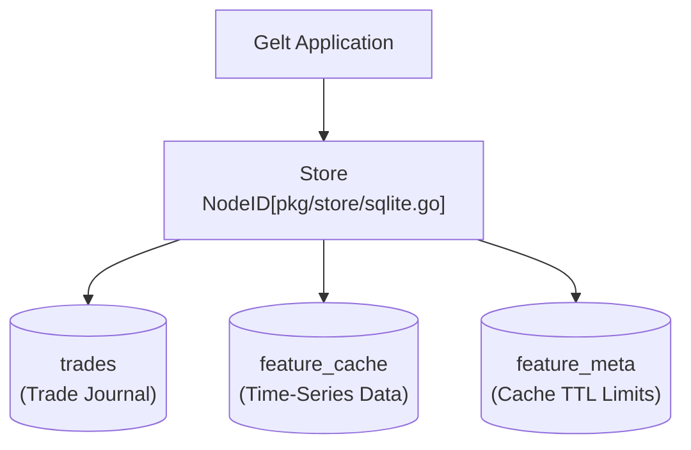

# `pkg/store`

This package encapsulates the embedded SQLite database used by Gelt for local trade journaling and time-series data caching.

## Architecture

## Features

- **Embedded SQLite**: Relies on `modernc.org/sqlite` pure-Go driver (no CGO dependencies).
- **Single Connection**: Actively limits connections (`SetMaxOpenConns(1)`) to avoid locking issues across background goroutines.
- **Asynchronous Writes**: Supports non-blocking `InsertTrade` executions to avoid stalling the core trading engine.
