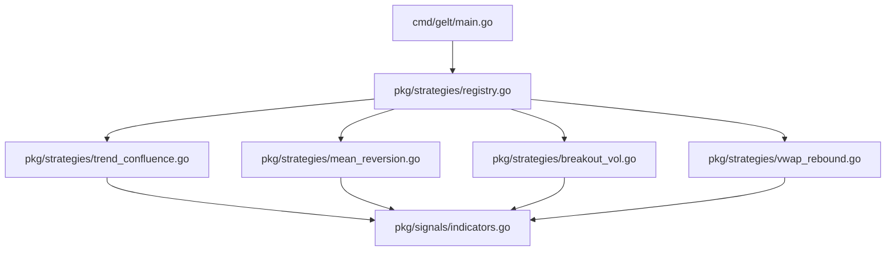

# Gelt Strategy Catalog (`pkg/strategies`)

The `pkg/strategies` package implements Gelt's quantitative Strategy Catalog, Strategy Interface, and dynamic Strategy Registry.

## Architecture

## Available Strategies

1. **`TrendConfluence`**: Multi-indicator momentum strategy combining 20/50 EMA, MACD, and RSI levels.
2. **`MeanReversion`**: Oversold bounce strategy combining 20-period Bollinger Bands and RSI < 35.
3. **`BreakoutVol`**: Signed latest close-change diagnostic versus the ATR-from-closes helper times a configurable expansion multiplier (default 1.25; period 14). Volume is not used. Scores 50/90 are fixed branch values, not calibrated probabilities.
4. **`VWAPRebound`**: Intraday institutional support pullback rebound strategy.
   - **Opt-in Trend Filter (`EnableTrendFilter`)**: Optional EMA 20/50 Macro Trend Alignment Gate (`.WithTrendFilter(true)`). Rejects `SignalBuy` if price < 20 EMA or 20 EMA < 50 EMA.
   - **Configurable Thresholds**: `MinDiffPct` (default `-0.2%`), `MaxDiffPct` (default `+0.3%`), `EMAFastPeriod` (20), `EMASlowPeriod` (50).

## BreakoutVol description boundary

The default close-change threshold uses `CalculateATRFromCloses`: its existing
proxy is 1.5 times the mean absolute change across the last 14 close differences,
then multiplied by the strategy expansion multiplier (default 1.25). It is not an
observed high/low true-range measurement. Positive/negative changes strictly
beyond that threshold return BUY/SELL with score 90; otherwise HOLD has score 50.
These constants do not estimate a probability, profitability or qualification.

This corrects prior descriptive claims of volume confirmation and a default
>1.5x expansion multiplier. It does not establish why that wording existed or
whether a future volume-confirmed strategy was intended. Calculations, defaults,
parameters, identity and signal results are unchanged; exported descriptive text
intentionally changes. Any volume/threshold behavior change needs a separate
versioned contract. See [the source-only correction specification](../../docs/specs/BreakoutVol-Description-Accuracy.md).

Configured ATR periods require at least period + 1 closes; `Evaluate` returns the helper error and a zero signal when that history is unavailable. The existing minimum of 20 closes and nonpositive-period fallback to 14 still apply. A computed zero ATR remains valid.

## MeanReversion ATR defaults

`NewMeanReversionStrategy` initializes the stop and target ATR multipliers to
0.5 and 1.5. These are uncalibrated model defaults; the historical pair is not
established. Positive `SetParams` overrides replace each multiplier independently,
while nonpositive ATR overrides are ignored. Default and partially overridden
signals therefore have different protection percentages from the previous zero
constructor values; explicitly setting both positive multipliers preserves those
configured evaluation inputs. These defaults do not establish market suitability
or trading safety.
