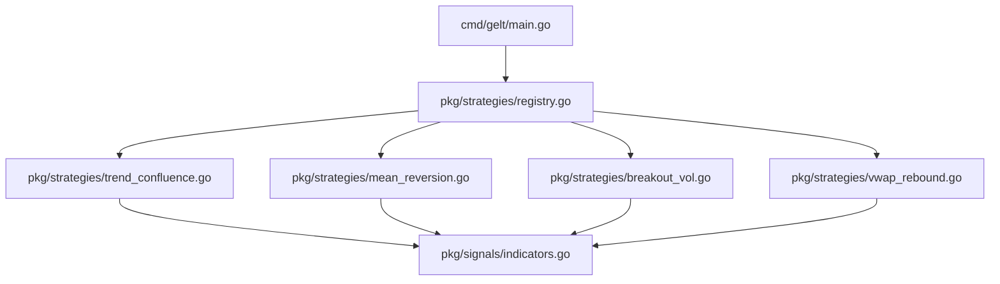

# Gelt Strategy Catalog (`pkg/strategies`)

The `pkg/strategies` package implements Gelt's quantitative Strategy Catalog, Strategy Interface, and dynamic Strategy Registry.

## Architecture

## Available Strategies

1. **`TrendConfluence`**: Multi-indicator momentum strategy combining 20/50 EMA, MACD, and RSI levels.
2. **`MeanReversion`**: Oversold bounce strategy combining 20-period Bollinger Bands and RSI < 35.
3. **`BreakoutVol`**: Volatility expansion breakout strategy confirmed by >1.25x ATR range expansion.
4. **`VWAPRebound`**: Intraday institutional support pullback rebound strategy.
   - **Opt-in Trend Filter (`EnableTrendFilter`)**: Optional EMA 20/50 Macro Trend Alignment Gate (`.WithTrendFilter(true)`). Rejects `SignalBuy` if price < 20 EMA or 20 EMA < 50 EMA.
   - **Configurable Thresholds**: `MinDiffPct` (default `-0.2%`), `MaxDiffPct` (default `+0.3%`), `EMAFastPeriod` (20), `EMASlowPeriod` (50).
