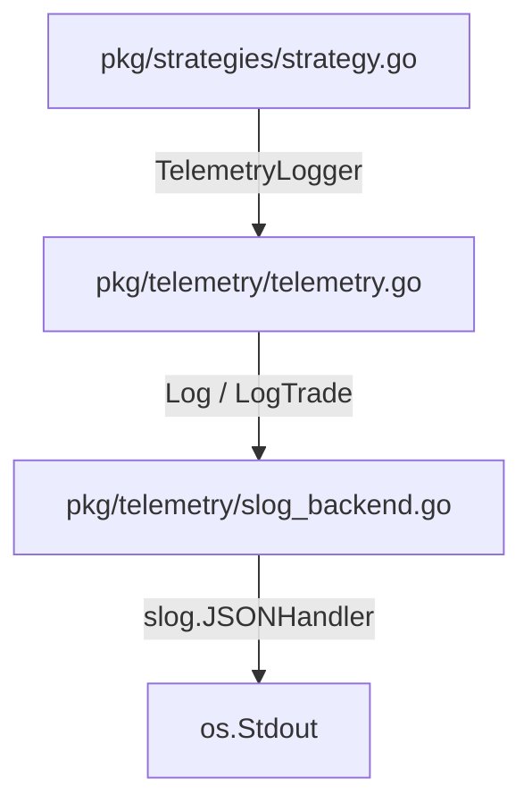

# Telemetry Logger

The `pkg/telemetry` package provides a unified, structured logging layer for the Gelt trading engine. It decouples the core system from specific logging implementations, enabling high-signal stdout events for cloud orchestration, automated agents, and CI/CD pipelines.

## Abstraction Layer

## Features

*   **Structured Context Tracing:** Uses Go's `log/slog` to output JSON formatted logs.
*   **Concurrency Safe:** The global logger instance is protected via a `sync.RWMutex`.
*   **Trade Specialization:** Native `LogTrade` method ensures strongly typed, consistently structured trade telemetry events.
