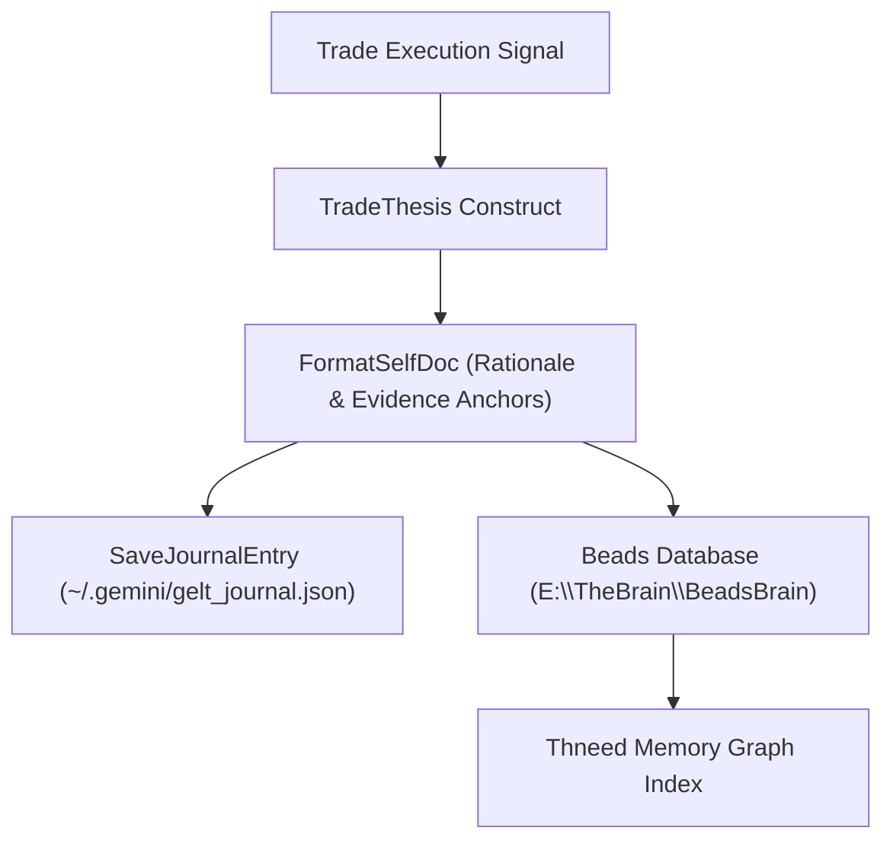

# Package thesis 📜

`pkg/thesis` provides structured trade thesis generation, local journal persistence, and Thneed GraphRAG synchronization (`GELT_BEADS_BRAIN_PATH`) for Gelt.

## Features

- **Structured Rationale & Evidence**: Generates `[bd-3qwe self-doc]` compliant rationale blocks prior to order execution.
- **Local Persistence**: Stores full trade history in `~/.gemini/gelt_journal.json`.
- **Thneed Brain Integration**: Syncs rationale and execution telemetry to `GELT_BEADS_BRAIN_PATH` for long-term AI strategy retrieval.
