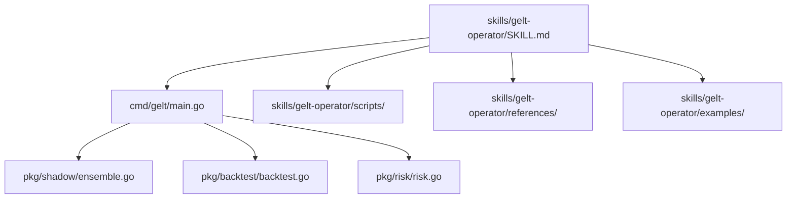

# Gelt Operator Skill Package (`gelt-operator`)

Operational skill for running backtests, multi-strategy ensemble shadow engines, risk governance limits, macro matrix polling, and telemetry dashboards in the Gelt Trading Engine.

## Architecture

## Description
Provides CLI execution instructions and diagnostic workflows for Gelt trading engine operations.
