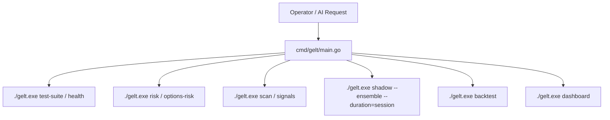

# Gelt Trading Engine Operator Skill 🪙

The `gelt-operator` skill equips AI agents with comprehensive operational commands and diagnostic workflows for managing the **Gelt Trading Engine** (`gelt.exe`).



## 1. Core CLI Commands

### Health & Pre-Market Verification
```bash
# Run comprehensive pre-market diagnostic test-suite across all modules
./gelt.exe test-suite

# Check live broker & MCP endpoint health
./gelt.exe health
```

### Risk Governance & Sizing
```bash
# Inspect active equity risk limits ($10 max trade, 20% max allocation, 3.0% stop-loss)
./gelt.exe risk

# Inspect options risk limits (contract premium caps, min DTE)
./gelt.exe options-risk
```

### Market Screening & Technical Indicators
```bash
# Evaluate technical indicator confluence score (RSI, EMA, MACD, Bollinger, ATR)
./gelt.exe signals SPY

# Run multi-ticker market screener across universe
./gelt.exe scan 70.0

# Monitor asset-calibrated trailing stops on active positions
./gelt.exe monitor
```

### Multi-Strategy Ensemble Shadow Engine
```bash
# Launch concurrent shadow simulation engine for current trading session
./gelt.exe shadow --ensemble --duration=session

# Inspect strategy leaderboard (live vs shadow metrics)
./gelt.exe shadow
```

### Backtesting & Macro Intelligence
```bash
# Run deterministic 100% offline backtest for a strategy or plan
./gelt.exe backtest IntradayAlphaPlan SPY 60

# Fetch non-blocking async macro economic indicators (EFFR, CPI, Yields via FRED)
./gelt.exe macro EFFR

# Evaluate current market volatility regime
./gelt.exe regime 28.5
```

### Telemetry & Web Dashboard
```bash
# View console telemetry & trade journal summary
./gelt.exe telemetry

# Launch local telemetry web server on port 8080
./gelt.exe dashboard
```

## 2. Operational Guardrails

1. **Deterministic Testing**: Always verify local binary execution with `./gelt.exe test-suite` before deploying changes or executing shadow sessions.
2. **Single-Subscription Optimization**: Leverage local offline backtesting (`pkg/backtest`) and async non-blocking macro caching (`pkg/macro`) to minimize external network latency and token usage.
3. **Beads Self-Doc Compliance**: Ensure shadow execution logs and trade theses are recorded to `GELT_BEADS_BRAIN_PATH` with `[bd-3qwe self-doc]` anchors.
