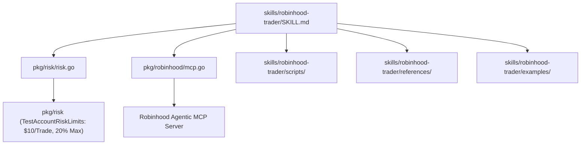

# Robinhood Trader Skill Package (`robinhood-trader`)

Automated risk-managed trading agent skill for Robinhood Agentic Trading via Model Context Protocol (MCP) and Gelt governance suite.

## Architecture

## Description
Equips AI agents with financial governance, technical indicator rules, and MCP order execution instructions for Robinhood Agentic Trading.
